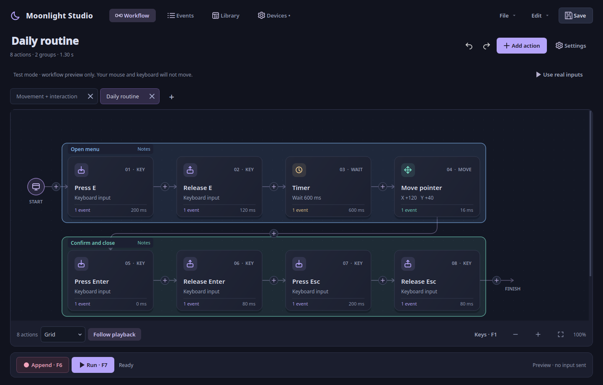
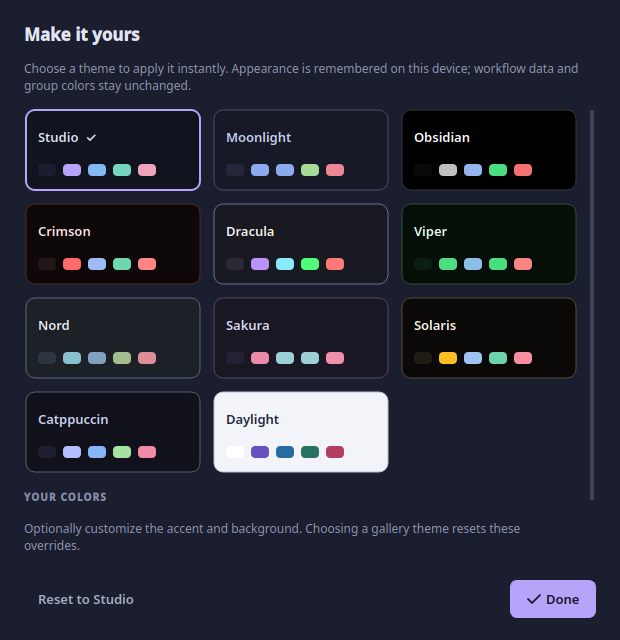
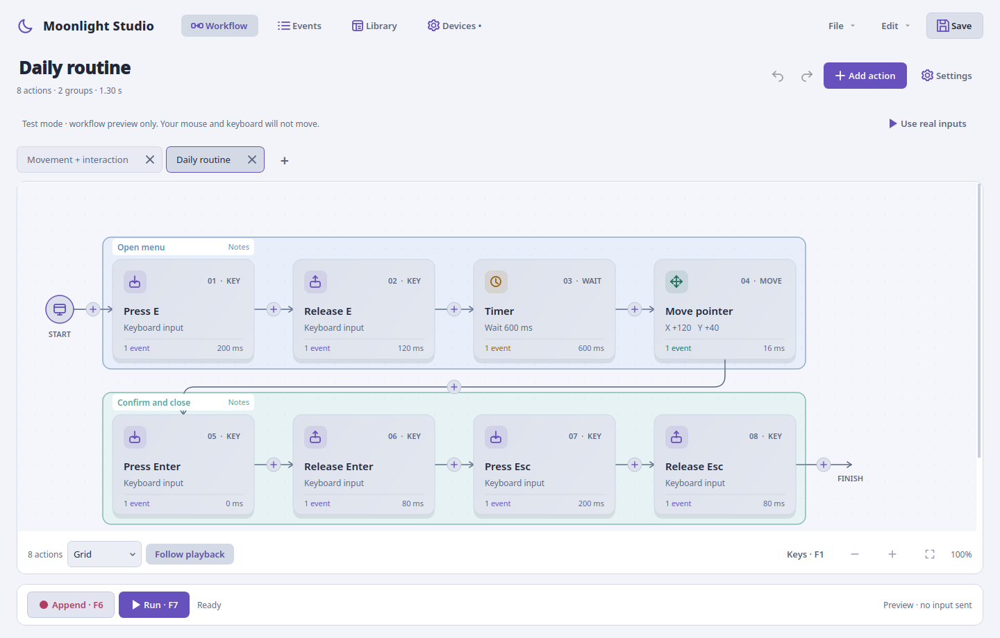

<div align="center">


# Moonlight Studio

**Record a routine. Make it yours. Run it again.**

A native Linux keyboard and mouse recorder with a visual workflow editor.
Inspired by [Moonlight](https://github.com/oNxZero/Moonlight).


[Get started](#get-started) · [User guide](docs/USER_GUIDE.md) · [Themes](#themes) · [Compatibility](#background-compatibility) · [Contribute](CONTRIBUTING.md)

</div>



## What you can do

- **Record and refine:** keyboard, buttons, relative movement and scrolling.
  Recording appends by default; re-record just a selected section when needed.
- **Build visually:** timed holds, separate Press/Release, timers, movement and
  scroll actions, with fixed or randomized timing. Original samples stay in Events.
- **Edit comfortably:** drag previews, box selection, copy/paste, duplicate, Undo/Redo,
  batch properties, and Horizontal, Vertical or responsive Grid layouts.
- **Explain sections:** group actions in colored rectangles with notes. Click a
  rectangle to edit its explanation. Groups do not change execution.
- **Understand playback:** cancellable countdown, per-loop starting coordinates,
  smooth camera follow, animated connections and retained last-run markers.
- **Keep several routines open:** tabs, searchable saved-file library, atomic JSON
  saves and per-tab recovery.
- **Make it yours:** eleven themes, live switching and accent/background overrides.

Workflows are linear sequences. Repeat the whole routine in Run settings.
Conditional branches, nested loops, gamepads, Windows and macOS are not implemented.

## Get started

Linux, Python 3.11+ and access to the repository are required.

```bash
git clone https://github.com/oNxZero/moonlight-studio.git
cd moonlight-studio
./start.sh
```

The launcher creates a local virtual environment and installs tested dependencies.
After updating, close the app and run `./start.sh` again. It refreshes changed
dependencies automatically. Run Studio as your regular user.

Try the editor without input permissions:

```bash
./start.sh --demo
```

The example opens in **Test mode**: the scheduler and highlights run without sending
inputs. **File → Getting started** and the empty workspace's **Quick guide** explain
the controls inside the app. `./start.sh --doctor` prints diagnostics.
See the [installation guide](docs/INSTALL.md) for manual setup and missing libraries.

## Your first workflow

1. **Create or open.** Click + beside the tabs, or open a JSON file. Right-click a
   tab to rename, save or close it.
2. **Record or add.** Select your keyboard/mouse in Devices and use F6. Add action
   inserts after the selection; a connector's + chooses the exact insertion point.
3. **Edit.** Click a card, change its properties and Apply. Ctrl-click or left-drag
   to select several. Duplicate copies them after the selection; Ctrl+Z undoes it.
4. **Preview.** Enable Test mode in Settings → Run and press F7. Check order, timing,
   start point and loops before using real input.
5. **Choose a destination.** Read the comparison below. Desktop playback uses your
   normal mouse and keyboard. F12 stops or cancels.
6. **Save.** Ctrl+S writes the JSON workflow. Recovery is separate from your named file.

**Hold vs Press:** Hold automatically releases after a duration. Press keeps a
key/button down; use a Timer and matching Release. Missing releases are cleaned up
on loop end, pause or Stop. Movement uses relative device counts, not screen
coordinates. Settings → Start configures an absolute cursor reset per loop.

## Themes

Open **File → Appearance & themes**, **Settings → Appearance & themes**, or press
**Ctrl+,**. Click Studio, Moonlight, Obsidian, Crimson, Dracula, Viper, Nord, Sakura,
Solaris, Catppuccin or Daylight to apply it immediately.

Customize the accent/background, or Reset to Studio. Appearance is remembered
locally and keeps your actions, notes, selection and run results intact. Group
colors remain in their workflow; their labels adapt for readable contrast.




## The workspace

| View | Use it for |
| --- | --- |
| Workflow | Select, rearrange and organize readable actions on one continuous canvas. |
| Events | Inspect/edit every original event, exact delay, code and relative coordinate. |
| Library | Search saved JSON files by filename/title; add another folder or refresh. |
| Devices | Choose physical devices, capture categories and check input access. |
| Action | Edit one action or matching selected actions; apply changed fields together. |
| Run | Choose the destination, Test mode, speed, repetitions and loop gap. |
| Start | Countdown, cursor reset and settle delay before each loop. |
| Group | Name/color a section and edit its notes. |

Wheel scrolls; middle-drag pans; Ctrl+wheel zooms. Turn **Follow playback** off to
inspect another section. Shorter-than-frame actions may not each get a separate
visual frame; timing comes from the replay worker.

## Keyboard shortcuts

| Shortcut | Action |
| --- | --- |
| F6 | Start / finish recording |
| F7 / F8 / F12 | Run or stop / pause or resume / emergency stop or cancel |
| Ctrl+N or Ctrl+T / Ctrl+O / Ctrl+S | New tab / open / save |
| Ctrl+W / Ctrl+Tab / Ctrl+Shift+Tab | Close / next tab / previous tab |
| Ctrl+Shift+S | Save as |
| Ctrl+C / Ctrl+X / Ctrl+V / Ctrl+D | Copy / cut / paste / duplicate actions |
| Ctrl+Z / Ctrl+Shift+Z | Undo / redo; text fields retain their own editing history |
| Ctrl+A / Delete / Esc | Select all actions / remove / clear selection |
| Ctrl+G / Ctrl+Shift+G / Ctrl+Shift+N | Group / ungroup / edit group notes |
| Shift+arrows / Alt+arrows | Extend selection / move selected actions |
| Ctrl+wheel / Ctrl+0 / F1 | Zoom / fit / shortcut help |
| Ctrl+, | Appearance and themes |

Global F-keys require a selected readable physical keyboard. Local controls also
work while Studio is focused. Reserved F-keys stay out of recordings and still
reach the foreground app; Studio does not grab physical devices.

## Background compatibility

| Mode | Behavior | Compatibility |
| --- | --- | --- |
| Active desktop | Uses your normal pointer/keyboard; focuses a chosen window after countdown. Switching away stops playback. | Linux uinput on Wayland/X11; physical input access required. |
| Background window · X11 | Sends messages to one existing window while another stays focused. Its pointer is virtual and window-local. | X11/Xwayland only; games and raw-input apps may ignore it. |
| Separate game session · Gamescope | Launches a new game on an independent display, leaving desktop input separate. | Requires Gamescope/GPU support and a compatible game; see [setup](docs/ISOLATED_SESSIONS.md). |

Choose an existing window by title/app; no executable picker is needed. KDE Plasma
includes native Wayland discovery. Other desktops currently list X11/Xwayland
windows. Existing native Wayland games cannot receive independent background input
through Studio. A separate session must launch a new game instance.

Mouse paths depend on sensitivity, acceleration, starting state and the game.
Retaining relative reports and timings does not guarantee pixel-identical paths
or game acceptance. A cursor reset does not reset a character or camera. See
[pointer support](docs/POINTER.md) and [validation](docs/VALIDATION.md).

## Linux device permissions

Editing and Test mode need no device permissions. Real recording needs read access
to selected `/dev/input/event*` devices; desktop playback also needs writable
`/dev/uinput`. Run as your regular user. Existing Moonlight permissions may suffice.

Use Devices → Input access help and the [installation guide](docs/INSTALL.md#input-permissions).
The launcher never changes system permissions. Input access can read keyboard
activity across applications; grant it only to trusted accounts.

## Files and privacy

Workflows contain JSON data, never executable Python. Existing v1/v2 files remain
readable. Groups use v3; group notes use v4. Older inline note cards convert in
memory; source files change only when you save. Portable files include events,
group notes and optional loop starting points. Destination handles and appearance
are not stored in them.

Preferences/recovery live in `$XDG_CONFIG_HOME/moonlight-studio` (normally
`~/.config/moonlight-studio`); its `scripts/` folder is the default library. Idle
changes recover separately every five seconds. Finish recording before closing;
force-killing the app can lose an in-progress capture.

Files use private permissions and atomic replacement. There is no telemetry,
account or cloud upload. Recorded input can contain personal text: review routines
before sharing. Root-level JSON recordings are ignored by Git.

## Development

[CONTRIBUTING](CONTRIBUTING.md) covers setup and checks. See [the audit](docs/AUDIT.md),
[validation](docs/VALIDATION.md) and [release readiness](docs/RELEASE.md) for fixes,
verified behavior and physical-desktop checks still requiring manual testing.

[Similar tools](docs/ALTERNATIVES.md) · [Roadmap](docs/PLAN.md) · [Earlier releases](docs/CHANGELOG.md) · [Security](SECURITY.md)
