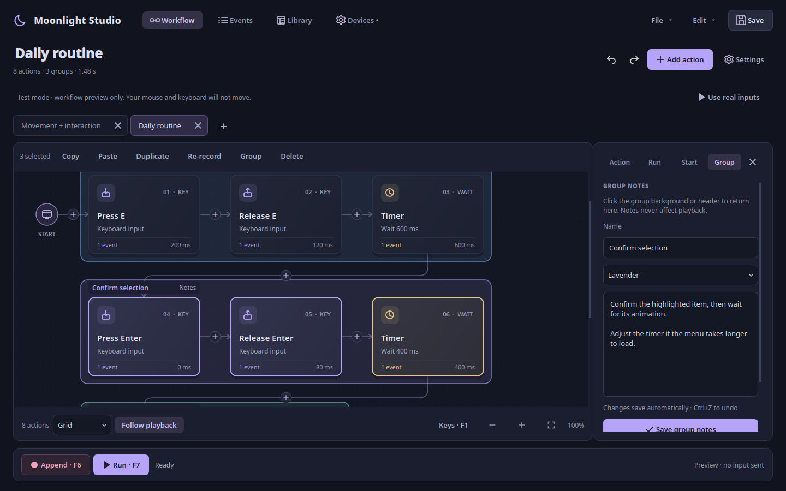
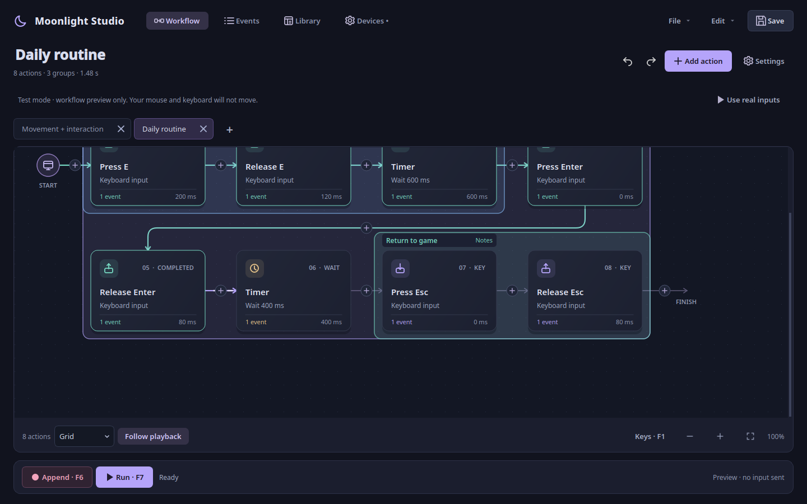
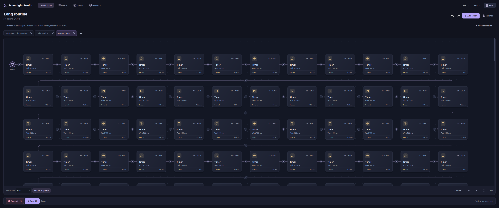
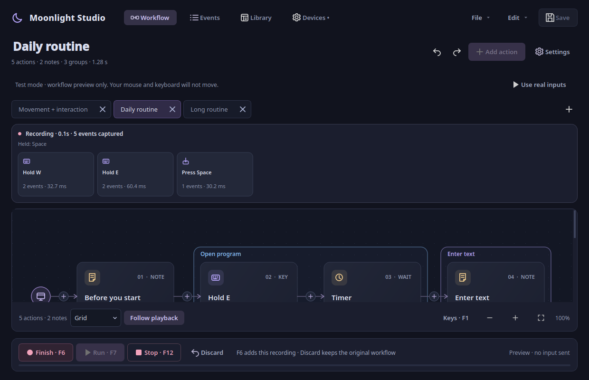
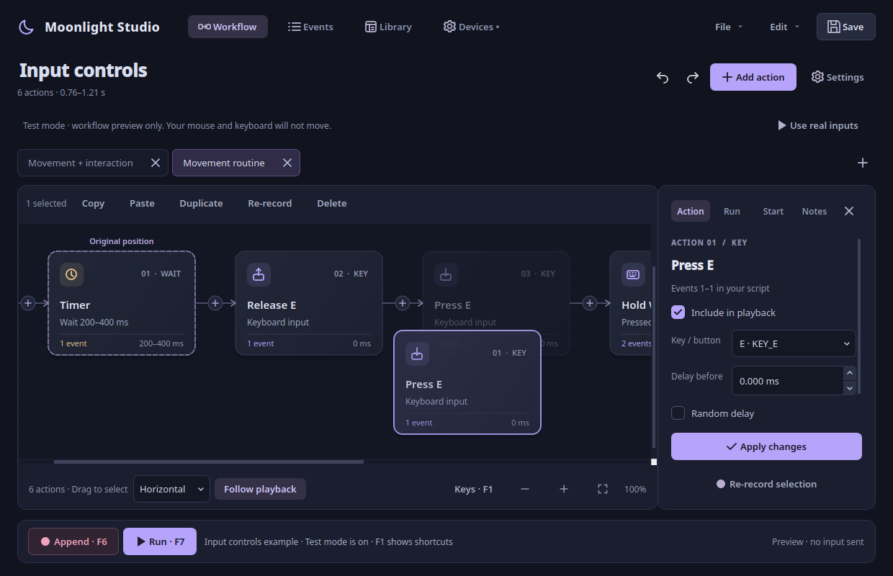
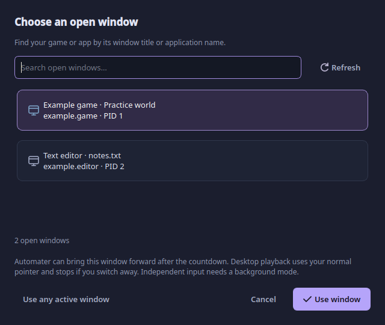
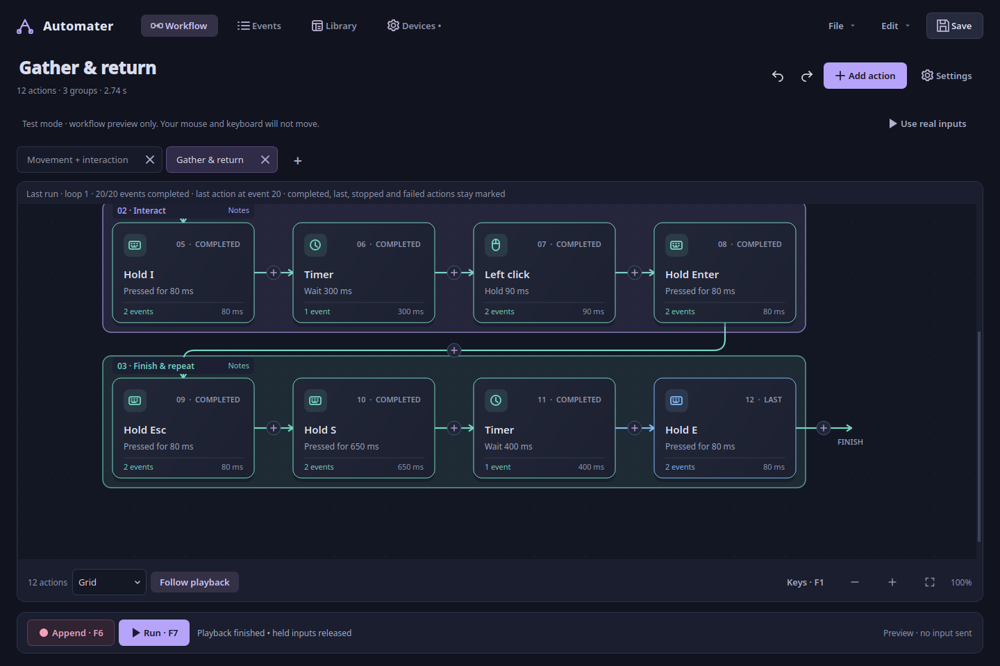
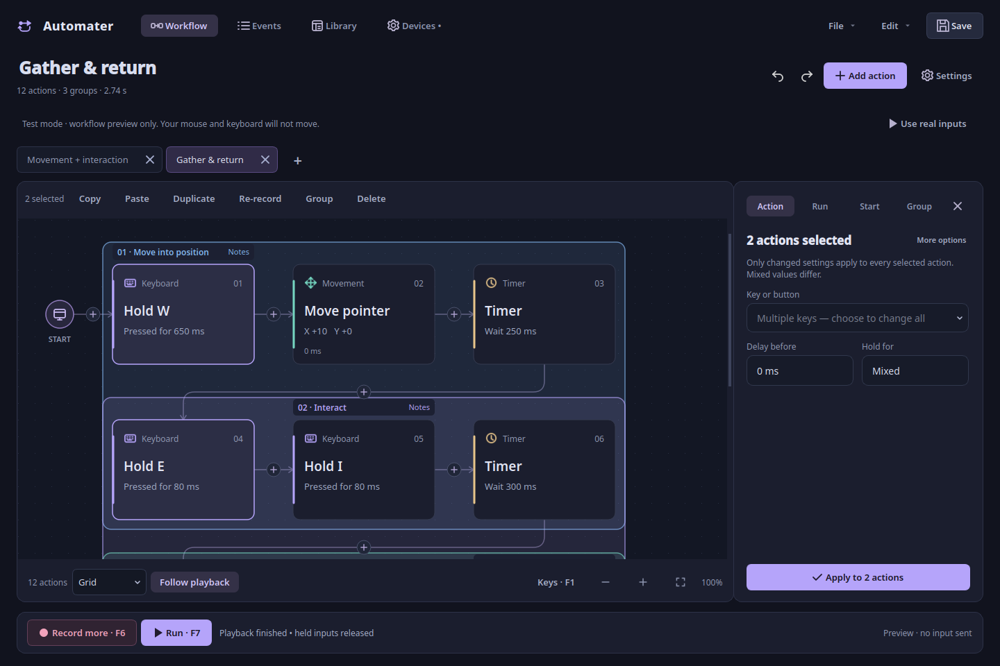

<div align="center">


# Moonlight Studio

**Turn your routine into a workflow.**

Record your keyboard and mouse. Shape the sequence visually. Run it your way.


A native Python desktop app inspired by [Moonlight](https://github.com/oNxZero/Moonlight).

[Get started](#get-started) · [The workspace](#the-workspace) · [User guide](docs/USER_GUIDE.md) · [Compatibility](#background-compatibility) · [Roadmap](docs/PLAN.md)

</div>


## A workspace built around your routine

The default view is a **left-to-right workflow**. A key hold becomes a readable
card. Mouse movements become a path. Waits become pauses you can see and edit.
Click an action to customize it; drag it to change its place in the sequence.
Your original input samples and timings stay available in the **Events** view.

| Build naturally | Stay in control | Keep your work |
| --- | --- | --- |
| Record with F6 or add actions yourself | Preview without sending inputs | Named workflow library with search |
| Connected keyboard, mouse, wait and path cards | Speed, repeats, start delay and loop gap | JSON import and export |
| Click a card to edit its properties | Pause, resume and F12 emergency stop | Atomic saves and autosave recovery |
| Insert between cards; duplicate or reorder | Watch the active action during replay | Undo / redo up to 50 event edits |

## New in v0.9: follow the flow, explain each section

- **Animated playback arrows:** connections light up as inputs progress. A moving
  stream shows the current transition; completed connections keep their color.
  Pause and Stop freeze the animation and retain the result.
- **Stable playback camera:** following tracks the latest input without jumping
  back to an older held key. It stops cleanly at scroll limits, retains the target
  while the grid reflows, and keeps its place when the last-run banner appears.
- **A + beside your tabs:** create a new workflow right where your open tabs are.
  Ctrl+T and right-click tab actions remain available.
- **Rectangle notes:** select actions and press **Ctrl+G** to place one colored
  rectangle behind them. Give it a name, color and explanation. Click its header
  or background to edit its notes in the **Group** panel. **Ctrl+Shift+N** opens
  notes for the selection; **Ctrl+Shift+G** ungroups.
- **Inline note cards removed:** explanations live on groups. Older note cards
  migrate to group notes when opened, preserving input order and timing. Source
  files change only when you save. Note-only files retain their text as an imported
  workflow description.
- **Safer metadata edits:** group notes save into the document automatically,
  survive tab changes, participate in Undo and copy/paste, and preserve last-run
  highlights. The notes panel scrolls at smaller window sizes.




## Introduced in v0.8: a workspace that fits your routine

- **Responsive grid:** columns adapt to window width, zoom and the inspector. A
  wide monitor uses its available space; resizing keeps your place in the routine.
- **Continuous camera motion:** playback retargets a damped camera without resetting
  its velocity. Short actions no longer restart an easing animation every frame.
  Turn Follow playback off whenever you want to inspect elsewhere.
- **Your saved JSON files in Library:** discover the library folder, known save
  locations, recently opened files and workflows saved beside the launcher. Add
  another folder, search filenames/titles and double-click to open. Scanning runs
  outside the UI thread and ignores unrelated JSON/configuration files.
- **Tab actions:** right-click a tab to rename, save, save as, close or close other
  workflows. Double-click renames too. Saved files are renamed in their current
  folder, with collision checks; unsaved edits remain in the tab.
- **Live recording preview:** see recent captured actions, elapsed time, event count
  and held keys while recording. Finish with F6 to add them; Discard keeps your
  previous workflow. The preview never writes partial captures into the undo stack.
- **Visual groups:** select actions and press Ctrl+G to create a named, colored
  category. v0.9 replaces standalone note cards with notes attached to the group's
  rectangle. Borders and explanations do not execute inputs or add playback time.
- **Clear save state:** unsaved changes sit beside the workflow summary. A custom
  Save / Discard / Keep editing dialog replaces the system question prompt.
- **Bring your app forward:** desktop playback can restore and focus the selected
  window after the countdown. The option is on by default. This still uses normal
  desktop input; independent background input needs a compatible X11 window or a
  separate game session.




## New in v0.7: continuous workflows and open-window selection

- **One continuous canvas:** all actions share the same scrollable workspace in
  Horizontal, Vertical and Grid layouts. Large routines render cards near the
  viewport to keep panning responsive, while retaining every event and selection.
- **Preview your drop:** dragging marks the original position, shows a translucent
  destination card and shifts neighbouring cards into their proposed order.
  Edge scrolling reaches distant actions. Escape cancels; a drop is one Undo.
- **Smooth playback follow:** the camera eases toward each running action instead
  of jumping. Turn **Follow playback** off to inspect elsewhere during a run.
- **Choose open windows:** Settings → Run → **Choose open window** searches by
  title or app name. KDE Plasma includes native Wayland windows; X11/Xwayland
  discovery is also available. Selecting a desktop window adds a focus check:
  switching away stops playback. Independent background input remains a separate mode.
- **More faithful timing:** replay keeps a cumulative timeline instead of adding
  scheduler overshoot to every mouse report. Late dispatch preserves recorded key/
  button hold and release intervals. Capture arms at the countdown deadline, and
  ready keyboard/mouse batches are merged by kernel timestamp.
- **Clearer files and tabs:** tabs sit directly above the canvas, with close buttons
  inside each tab. Saved tabs use the filename. Open and Save As share an existing,
  remembered folder and handle relative filenames inside that folder.




## New in v0.6: separate game sessions, tabs and run results

- **Independent game input:** Settings → Run → Separate game session starts Sober
  or a custom application inside Gamescope. Playback uses that display's mouse and
  keyboard, leaving your normal desktop input independent. Close an existing Sober
  instance first; it cannot be moved into the new display. GPU/game compatibility
  still requires testing. See [the setup guide](docs/ISOLATED_SESSIONS.md).
- **Workflow tabs:** open multiple scripts, each with its own changes, undo/redo,
  view, run settings and recovery file. New/open keeps existing work. Ctrl+T opens
  a tab, Ctrl+W closes it, and Ctrl+Tab switches. Tabs lock during capture/playback.
- **Worker-clock feedback:** countdown uses the actual replay deadline. The UI
  distinguishes delay, timer, held input, reset, settle, pause and loop gap; it no
  longer labels an upcoming input as already running. GUI polling is 30 Hz and
  action rendering is limited to cards near the visible area.
- **Keep the last run:** completed actions remain green; the last completed action
  is blue, an interrupted action amber and a failed step red. Marks belong to the
  workflow tab and clear on edits/new playback. Edit → Last playback details shows
  completed events, failure and measured scheduler lateness.
- **Mouse report fidelity:** X/Y from one physical report replay together instead
  of separate synthetic reports. Counts and frame spacing are retained. Exact
  screen/camera paths still depend on acceleration, sensitivity and game state.



## New in v0.5: edit together, record safely

- **Batch properties:** select matching actions and edit their key, timing, random
  range, enabled state or movement. Only changed fields apply; mixed values are
  marked. Apply is one undoable change.
- **Desktop-style selection:** left-drag empty canvas to box-select. Middle-drag
  pans; Ctrl-click toggles cards and Shift-click extends a range.
- **Append by default:** Record adds to your workflow. Empty or discarded captures
  keep existing actions. Replacing the entire workflow asks first.
- **Re-record selection:** choose one action or adjacent actions, then Re-record.
  Finish with F6, discard with the on-screen Discard button, or undo afterward.
- **Pointer guides:** Show pointer path displays a temporary, click-through screen
  guide. Choose on screen selects a starting point; Show starting point marks it.
- **Wayland positioning:** KDE/GNOME-compatible desktop portals can authorize
  absolute pointer positioning. Connect in Settings → Start and approve monitors.
  No permission prompt is opened automatically. Requires a compatible portal backend.
- **Clear playback mode:** a visible Test mode explanation and Use real inputs
  button prevent confusing previews with real playback. Local F-keys also work
  while the app is focused when global device monitoring is unavailable.
- **Smoother visuals:** short card hover/selection transitions, fading guides and
  rounded grid connector corners. Extra timing fields appear only when needed.



See the [bug and usability audit](docs/AUDIT.md) for fixes and remaining checks.

## New in v0.4: a complete input editor

- **Press, Hold, Release and Timer:** search the Linux keyboard/button list, choose a
  key, set its delay and duration, then add the action. Holds release automatically;
  Press stays down until Release, loop end or Stop.
- **Random timing:** set minimum/maximum delays or hold durations. Each event samples
  a fresh value on every loop. Select several actions → Edit → Randomize selected
  timing to apply percentage variation in one undoable change.
- **Real editing controls:** Ctrl/Shift multi-selection, left-drag box selection,
  copy/cut/paste, duplicate, delete, selection-wide enable/disable and undo/redo.
  Copy/paste retains keys, timers, ranges and grouping metadata.
- **Three layouts:** Horizontal, Vertical and Grid. Playback order stays numbered;
  changing layout never changes event data. Selection is retained while scrolling.
- **Loop starting point:** reset to an X/Y position before **every** loop, allow a
  settle delay, then begin the action sequence. Starting points are stored with
  the workflow. Desktop resets support X11 and Hyprland; background mode uses
  target-window coordinates without moving the real cursor.
- **A visible starting countdown:** Record, Run and coordinate picking show a
  cancellable countdown. F12 stops/cancels. The active action, sampled timing and
  loop are shown during replay. Transport buttons show their F-key shortcuts.
- **Clearer icons and shortcut help:** distinct press/release symbols, larger
  transport icons, an Edit menu, and **Keys · F1** on the canvas.

Open **File → Input controls example** to try the new actions in Test mode.

## New in v0.3

- **A quieter workspace:** one navigation row, no sidebar or duplicate tabs, properties
  open on demand, and Pause/Stop only appear during active work.
- **Linux device discovery fixed:** actual evdev objects are opened and closed correctly.
  Keyboard/mouse identification filters unrelated power and gamepad interfaces.
- **Remembered device choices:** selections survive event-node renumbering when the
  device provides a stable physical/unique identifier. Recommended restores defaults.
- **Remembered run and capture settings:** speed, repeats, countdown, gap and filters
  persist locally across restarts.
- **Append recording:** optionally add a recording to the existing workflow. Undo
  restores the previous sequence. Replacement remains the default.
- **Clearer diagnostics:** permissions, unsupported absolute movement and disconnects
  are explained in Devices; raw diagnostics stay behind Technical details.

## See it in motion

An actual Test mode run in the native Qt interface. No input is sent.


## Get started

**Already have the project?** Close the old app and launch it again:

```bash
cd moonlight-studio
./start.sh
```

**Fresh install:** Linux and Python 3.11+ are required.

```bash
git clone https://github.com/oNxZero/moonlight-studio.git
cd moonlight-studio
./start.sh
```

The repository is private; cloning requires access to your GitHub account.
The launcher creates a local virtual environment and installs the tested runtime
dependencies on its first run. Existing installations load the new UI on restart;
v0.1 JSON scripts remain compatible.

Want to explore first? No input permissions are needed for the demo:

```bash
./start.sh --demo
```

It opens the example with **Test mode** enabled. Press **Run** and watch
it progress through the cards. To print input/session diagnostics instead:

```bash
./start.sh --doctor
```

<details>
<summary><strong>Manual installation & system dependencies</strong></summary>

```bash
python3 -m venv .venv
.venv/bin/python -m pip install -c requirements.lock -e .
.venv/bin/moonlight-studio
```

If evdev needs to compile, install your distribution's Python development headers,
a compiler, and Linux input headers (Fedora: `python3-devel gcc kernel-headers`;
Debian/Ubuntu: `python3-dev build-essential`). Qt needs system EGL/OpenGL libraries.
On a minimal Debian/Ubuntu install, use `libegl1 libopengl0 libgl1 libxkbcommon0
libxcb-cursor0`. Qt's Wayland plugin is included; X11 uses system XCB libraries.
Run as your regular user. The [permissions guide](#linux-device-permissions) covers
physical input access separately.

</details>

## Your first workflow

1. **Connect.** Open **Devices**, select your keyboard and mouse, and click
   **Apply selection**. Choose whether to capture keyboard, buttons/wheel,
   and mouse movement.
2. **Record.** Press **F6**, switch to your game during the countdown, and perform
   the routine. Press **F6** again to finish. Undo can restore the previous routine. Record appends by default; select an action and use **Re-record** to replace just that part.
3. **Make it yours.** Click a workflow card. Change its key, delay, hold duration,
   or enabled state in **Action**, then click **Apply changes**. Use **Events** for
   individual press/release events and mouse samples.
4. **Preview.** Open **Settings → Run**, enable **Test mode**, and click
   **Run**. The active action and progress are highlighted without sending input.
5. **Run.** Turn Test mode off, choose the destination, speed and repetitions, then
   press **F7**. Keep **F12** handy to stop. Save your workflow for next time.

## The workspace

| View | What you do there |
| --- | --- |
| **Workflow** | Follow your routine from Start to Finish. Select cards, insert at a connector, drag to reorder, zoom and pan. |
| **Events** | Inspect every original input. Double-click cells to edit precise delays, actions, keys and relative coordinates. |
| **Library** | Search saved workflows, double-click to open, or import a JSON script. |
| **Devices** | Check input access, select physical devices, choose capture categories and find permissions help. |
| **Action inspector** | Edit the selected action, apply changes, duplicate, delete or move it. |
| **Run inspector** | Choose desktop, an existing X11 window, or a separate game session; speed, repeats, loop gap and Test mode. |
| **Start inspector** | Configure the initial countdown and the per-loop cursor reset. |
| **Group inspector** | Name/color a selected section and explain it with group notes. |

**Canvas controls:** Ctrl-click adds/removes actions from selection; Shift-click
selects a range, and left-drag on empty canvas box-selects. Scroll horizontally with the mouse wheel; middle-drag the background
to pan; hold **Ctrl** and scroll to zoom. Use **Fit** to reframe the workflow.
The plus buttons between cards insert an action at that exact point. The Add action
dialog supports independent Press and Release as well as timed holds. Right-click a
card for duplicate, enable/disable, move and delete. Arrow keys select actions; Shift + arrows extend selection. **Alt + arrows** moves
the selection. **Delete** removes selected actions. Ctrl+A selects the entire workflow.
The layout selector switches Horizontal / Vertical / Grid. Press F1 for all shortcuts.

**Recording detail stays intact.** Adjacent matching press/release events become
one hold/click card. Consecutive recorded movement or scroll samples share a card, while
Events retains every sample. Overlapping key holds stay separate. Large workflows
use one continuous, virtualized canvas to keep scrolling responsive. This is a linear
sequence; repeat the whole workflow in Settings → Run. Branches and nested loops
remain on the roadmap.

Read the [illustrated user guide](docs/USER_GUIDE.md) for timing, grouped-path editing,
recovery and common questions.

## Keyboard shortcuts

| Shortcut | Action |
| --- | --- |
| **F6** | Start / finish recording, or cancel its countdown |
| **F7** | Start / stop playback |
| **F8** | Pause / resume playback |
| **F12** | Stop recording, countdown, or playback |
| Ctrl+N or Ctrl+T / Ctrl+O / Ctrl+S | New tab / open in a tab / save active tab |
| Ctrl+W / Ctrl+Tab / Ctrl+Shift+Tab | Close tab / next tab / previous tab |
| Ctrl+Shift+S | Save as |
| Ctrl+Z / Ctrl+Shift+Z | Undo / redo event edits |
| Ctrl+C / Ctrl+X / Ctrl+V | Copy / cut / paste selected actions |
| Ctrl+D / Ctrl+A | Duplicate / select the whole workflow |
| Ctrl+G / Ctrl+Shift+G | Group / ungroup selected actions |
| Ctrl+Shift+N | Open notes for the selection, or create its group |
| Esc | Clear selection |
| Shift + arrows / left-drag empty space | Extend selection / box-select |
| Ctrl+wheel / Ctrl+0 | Zoom / fit |
| F1 | Workflow shortcut help |
| ← / → on the canvas | Select previous / next action |
| Alt + ← / → on the canvas | Move the selected action |
| Delete on the canvas | Delete the selected action |

Global F-keys need a selected, readable physical keyboard. They are reserved and
excluded from recordings, but still reach the foreground app. Studio does not grab
devices. Virtual output is excluded from monitoring to prevent feedback. Pause
releases held inputs; resume presses their logical holds again. Loop boundaries
release all held keys and buttons.

## Similar tools

Yes—there are other macro recorders and desktop automation tools. For Linux,
[AutoKey for Wayland](https://autokey-wayland.readthedocs.io/en/latest/) and
[atbswp](https://github.com/RMPR/atbswp) are relevant comparisons. On Windows,
[Pulover’s Macro Creator](https://www.macrocreator.com/) offers a recorder and visual
macro editing; [Macro Recorder](https://www.macrorecorder.com/) supports Windows and
macOS. See the [comparison and platform notes](docs/ALTERNATIVES.md).

## Linux device permissions

If your existing Moonlight clicker works, its permissions may already be sufficient.
Otherwise, an administrator needs to load `uinput` and grant your account read access
to the selected `/dev/input/event*` devices and write access to `/dev/uinput`.
**Run the application as your regular user.**

One optional persistent setup, similar to the original Moonlight installer:

```bash
sudo modprobe uinput
sudo groupadd -f input
sudo usermod -aG input "$USER"
sudo tee /etc/udev/rules.d/99-moonlight-studio.rules >/dev/null <<'RULES'
SUBSYSTEM=="misc", KERNEL=="uinput", GROUP="input", MODE="0660", OPTIONS+="static_node=uinput"
SUBSYSTEM=="input", KERNEL=="event*", GROUP="input", MODE="0660"
RULES
sudo udevadm control --reload-rules
sudo udevadm trigger
```

Log out and back in for group membership to take effect, then refresh devices.
If your system does not load uinput on boot, an administrator can add `uinput` to
`/etc/modules-load.d/moonlight-studio.conf`. Existing distribution/udev policies
may require different rules. This setup grants broad access to physical input,
including keyboard activity across applications; restrict it to trusted users.
The launcher never changes system permissions itself. Stop recording before typing
anything you do not want included in a saved macro.

After unplugging or reconnecting a device, stop active work and refresh devices.
Disconnects and dropped event buffers stop active work with an error rather than
continuing a potentially incomplete recording.

## Loop starting coordinates

Click **Settings → Start**, or click the Start marker on the canvas. Set the starting
countdown, enable **Move to this point before every loop**, enter X/Y, and choose a
settle delay. **Pick position · 3 s** captures your current desktop position
after a three-second countdown, letting you place the pointer first.

- **X11 desktop:** coordinates are desktop screen pixels. The move is verified.
- **Hyprland desktop:** coordinates use Hyprland's global logical layout, including
  monitor scale and negative monitor positions. `hyprctl` is required.
- **Background X11 window:** coordinates are client pixels relative to the selected
  window, starting at its top-left. This resets the virtual cursor, not your real one.
- **Other Wayland desktops, including KDE:** click **Connect Wayland pointer**
  in Settings → Start and approve pointer control and the monitors in the desktop
  dialog. A compatible RemoteDesktop/ScreenCast portal is required. Coordinates
  must be inside approved monitors. No screen frames are opened or saved.
  Studio never substitutes an Xwayland warp for a native desktop reset.

Reset runs after the initial countdown and before each loop's first action. Held
inputs are released between loops; then the next reset occurs. Invalid coordinates
or reported movement errors stop playback before keys. Portal calls acknowledge
requests; game acceptance still requires testing on your desktop.
Test mode simulates the reset without moving anything. A cursor point does not reset
your character, camera or game state. See [platform implementation notes](docs/POINTER.md).

## Background compatibility

| Target | Desktop replay | Background replay |
| --- | --- | --- |
| Native Wayland application | uinput | Unsupported |
| X11 application | uinput | Experimental directed X11 events |
| Xwayland application | uinput | Experimental directed X11 events |
| Windows / macOS | Future backend | Future assessment |

Click **Choose open window** to search running windows by title or application.
KDE Plasma discovery includes native Wayland windows; other desktops currently list
X11/Xwayland windows. No executable file is needed to select an existing window.
Active desktop uses your normal pointer. By default it brings the chosen window
forward after the countdown; the window must then stay focused. Independent input uses Existing window (best effort) or a new Gamescope
session. Window identity and liveness are checked during playback; losing the
target stops playback. Background key mapping assumes the standard Xorg/Xwayland
evdev XKB mapping. Background mouse movement is a virtual cursor starting in the
window center, clamped to its initial client bounds. It is not raw camera motion.
Some applications expect input on a child widget instead of the selected top-level
window; those applications may not respond. Synthetic events do not update global
physical key state. Raw-input games, minimized apps, and protected games may ignore
them. There is no anti-cheat bypass or injection into a game's process.

This release captures ordinary keyboard codes, supported mouse buttons, and
relative motion/wheel. It does not capture touch/absolute devices, gamepads, IME
composition, or high-resolution wheel metadata. Linux keyboard codes outside the
ordinary keyboard range are not recorded. Background mode supports keycodes that
fit X11's 8–255 range and at most 100 scroll notches per step. Relative paths depend
on the starting pointer/camera position, game sensitivity, acceleration, and bindings;
they are not screen-coordinate recordings. Scripts have a 200,000-step limit.

## Files and privacy

Device selections and run/capture preferences are saved privately in `preferences.json`.
Window handles are never restored across restarts. These preferences are per application;
existing version-1 macro files remain readable. Scripts using advanced controls or
starting coordinates are saved in version 2. Named visual groups use version 3;
group explanations use version 4 and require Studio v0.9 or newer. Older inline
note cards convert to group notes when opened. Plain version-1/2 workflows retain
their format when newer features are unused; explicitly loaded versions are retained.

Configuration lives in `$XDG_CONFIG_HOME/moonlight-studio` (normally
`~/.config/moonlight-studio`). Saved library scripts are under `scripts/`;
unfinished edits are autosaved to per-tab `recovery-*.json` files every five seconds while idle.
Stopping a recording also autosaves its result. Recordings in progress are held
in memory until stopped. Autosave does not overwrite your named script. A clean
save clears recovery; normal close prompts for unsaved changes. An incomplete
recording can be lost if the process is force-killed before stopping.

Macro files contain versioned JSON data, never executable Python. They contain
your recorded input, so keep them private. No telemetry, network calls, or cloud
uploads are implemented. Files are written with private permissions and atomically
replaced. Imports are limited to 32 MiB and strictly validated before replay.

Desktop replay waits at least 0.5 s after creating a virtual device so the desktop
has time to register it; this wait can be cancelled. Actual registration timing
still depends on the compositor.

The replay worker is separate from Qt's event loop. Stop and cleanup run on normal
completion, cancellation, errors, pause, and application close. Force-killing the
process or losing power cannot run Python cleanup code. Hardware behavior still
needs testing on your compositor and target game; see [validation](docs/VALIDATION.md).

## Development

```bash
.venv/bin/python -m pip install -c requirements.lock -e '.[dev]'
QT_QPA_PLATFORM=offscreen .venv/bin/python -m pytest -q
.venv/bin/ruff check src tests
.venv/bin/ruff format --check src tests
.venv/bin/python -m build
```

X11 integration tests use an unmapped controlled receiver and never change focus.
They skip if no X server is available. To run everything on a headless machine,
install Xvfb and run `xvfb-run -a env QT_QPA_PLATFORM=offscreen .venv/bin/python -m pytest -q`.

See the [complete feature plan and roadmap](docs/PLAN.md), [script format](docs/FORMAT.md),
and [verification evidence](docs/VALIDATION.md). Source is independently implemented;
Moonlight supplies the product direction and color palette. Qt is distributed under
its upstream license; dependency licenses remain their respective owners'.
