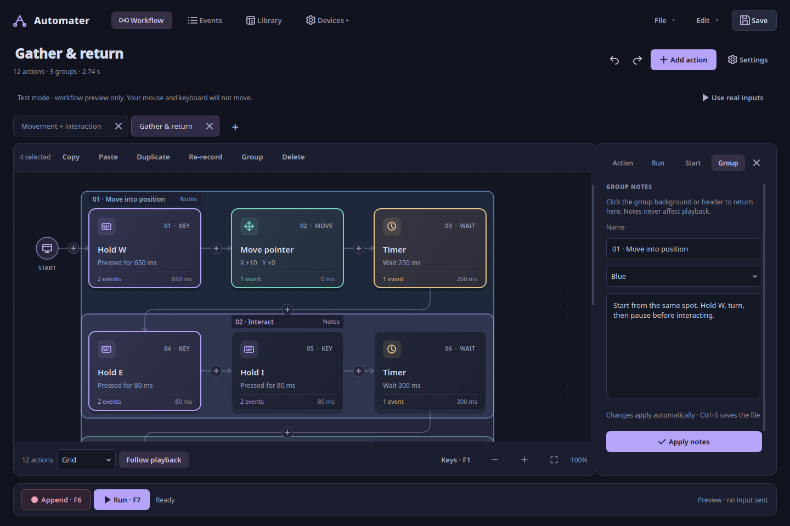
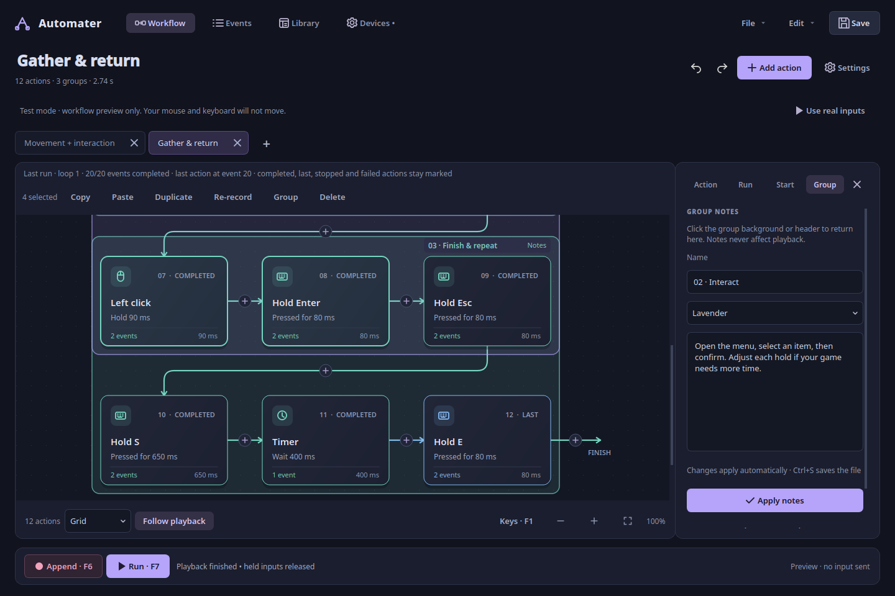
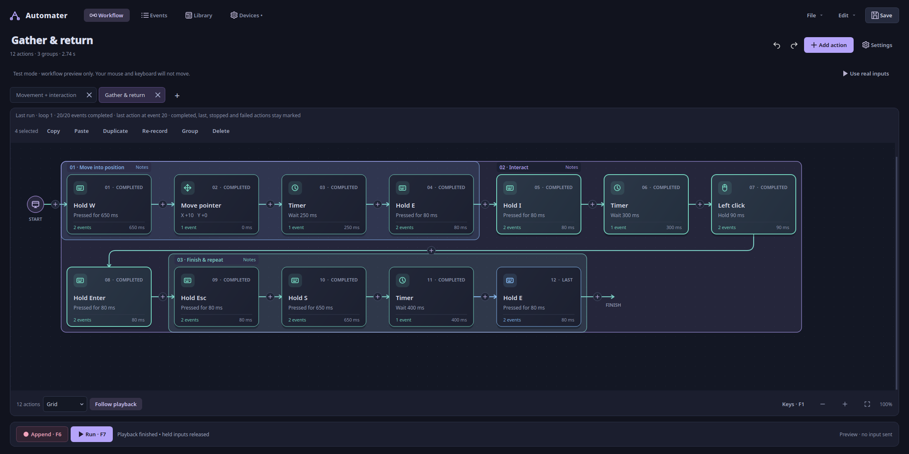
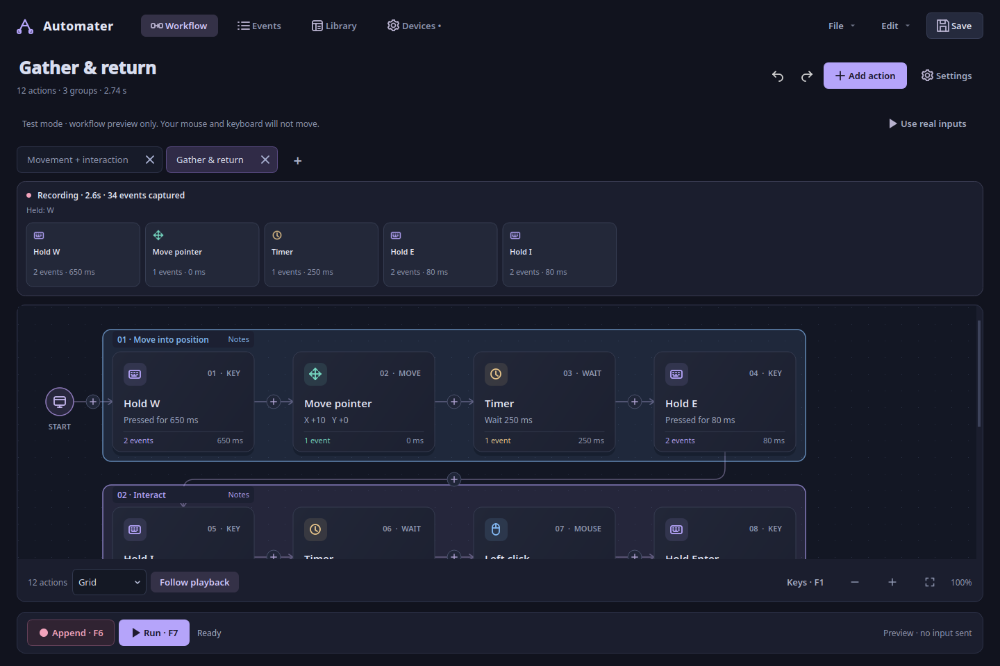
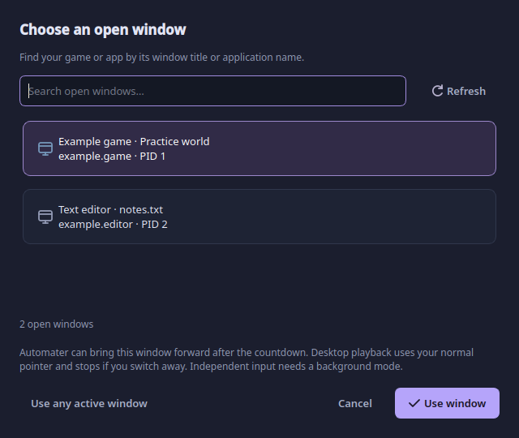
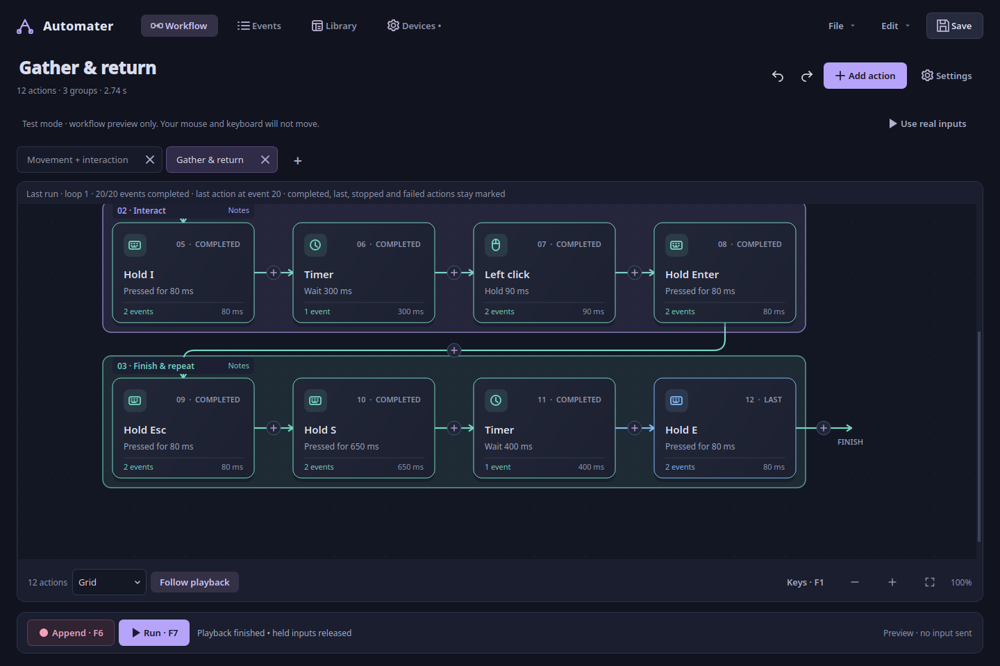
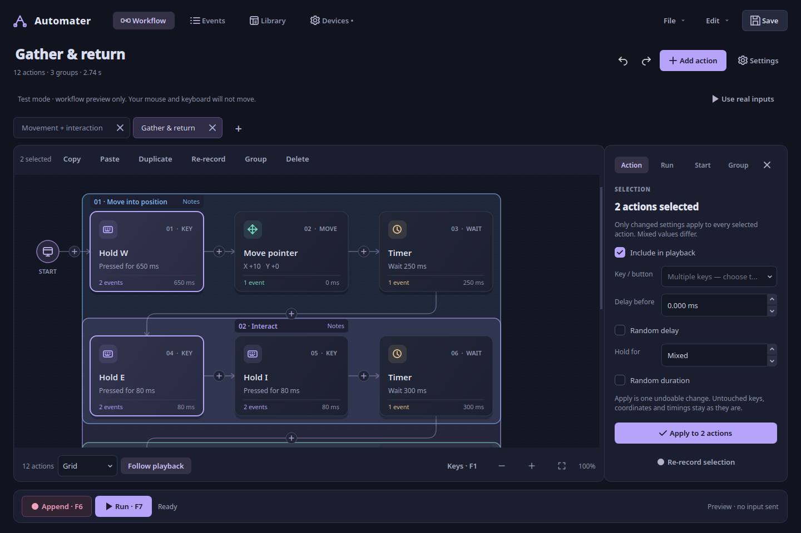

# Earlier release notes

## v0.12.0 · Automater and desktop installation

- The application, repository, Python package/command, window integration and
  documentation now use Automater. The default theme is also named Automater.
- First launch copies earlier settings, default-library workflows and recovery
  files into the new config directory. Original files remain untouched and existing
  Automater settings take priority. Library paths and the original default theme
  migrate with them. Portable workflow JSON stays compatible.
- `install.sh` installs supported distro dependencies, prepares the tested runtime
  and registers a per-user application-menu entry with an example action. Use
  `--no-system-packages` to skip system-package installation. Input permissions are
  configured separately in Devices.
- README now includes a complete installation code block, update/removal steps and
  refreshed native Qt screenshots with an Automater icon. Screenshot generation uses
  synthetic workflows only and is reproducible with `scripts/screenshots.py`.
- Regression checks cover migration, failed-copy cleanup, real desktop-entry parsing,
  unusual installation paths, installer failure ordering and shortcut-only removal.

Current features and setup are in the [README](../README.md).

## Fixed in v0.9.1: uninterrupted note editing

Saving group notes preserves your typing position, selected text, scroll position
and text undo history. Pausing while writing no longer sends the cursor back to
the start of the description. Name-field selections also survive saving.

## New in v0.9: follow the flow, explain each section

- **Animated playback arrows:** connections light up as inputs progress. A moving
  stream shows the current transition; completed connections keep their color.
  Pause and Stop freeze the animation and retain the result.
- **Stable playback camera:** following tracks the latest input without jumping
  back to an older held key. It stops cleanly at scroll limits, retains the target
  while the grid reflows, and keeps its place when the last-run banner appears.
- **A + beside your tabs:** create a new workflow right where your open tabs are.
  Ctrl+T and right-click tab actions remain available.
- **Rectangle notes:** select actions and press **Ctrl+G** to place one colored
  rectangle behind them. Give it a name, color and explanation. Click its header
  or background to edit its notes in the **Group** panel. **Ctrl+Shift+N** opens
  notes for the selection; **Ctrl+Shift+G** ungroups.
- **Inline note cards removed:** explanations live on groups. Older note cards
  migrate to group notes when opened, preserving input order and timing. Source
  files change only when you save. Note-only files retain their text as an imported
  workflow description.
- **Safer metadata edits:** group notes save into the document automatically,
  survive tab changes, participate in Undo and copy/paste, and preserve last-run
  highlights. The notes panel scrolls at smaller window sizes.

## Introduced in v0.8: a workspace that fits your routine

- **Responsive grid:** columns adapt to window width, zoom and the inspector. A
  wide monitor uses its available space; resizing keeps your place in the routine.
- **Continuous camera motion:** playback retargets a damped camera without resetting
  its velocity. Short actions no longer restart an easing animation every frame.
  Turn Follow playback off whenever you want to inspect elsewhere.
- **Your saved JSON files in Library:** discover the library folder, known save
  locations, recently opened files and workflows saved beside the launcher. Add
  another folder, search filenames/titles and double-click to open. Scanning runs
  outside the UI thread and ignores unrelated JSON/configuration files.
- **Tab actions:** right-click a tab to rename, save, save as, close or close other
  workflows. Double-click renames too. Saved files are renamed in their current
  folder, with collision checks; unsaved edits remain in the tab.
- **Live recording preview:** see recent captured actions, elapsed time, event count
  and held keys while recording. Finish with F6 to add them; Discard keeps your
  previous workflow. The preview never writes partial captures into the undo stack.
- **Visual groups:** select actions and press Ctrl+G to create a named, colored
  category. v0.9 replaces standalone note cards with notes attached to the group's
  rectangle. Borders and explanations do not execute inputs or add playback time.
- **Clear save state:** unsaved changes sit beside the workflow summary. A custom
  Save / Discard / Keep editing dialog replaces the system question prompt.
- **Bring your app forward:** desktop playback can restore and focus the selected
  window after the countdown. The option is on by default. This still uses normal
  desktop input; independent background input needs a compatible X11 window or a
  separate game session.

## New in v0.7: continuous workflows and open-window selection

- **One continuous canvas:** all actions share the same scrollable workspace in
  Horizontal, Vertical and Grid layouts. Large routines render cards near the
  viewport to keep panning responsive, while retaining every event and selection.
- **Preview your drop:** dragging marks the original position, shows a translucent
  destination card and shifts neighbouring cards into their proposed order.
  Edge scrolling reaches distant actions. Escape cancels; a drop is one Undo.
- **Smooth playback follow:** the camera eases toward each running action instead
  of jumping. Turn **Follow playback** off to inspect elsewhere during a run.
- **Choose open windows:** Settings → Run → **Choose open window** searches by
  title or app name. KDE Plasma includes native Wayland windows; X11/Xwayland
  discovery is also available. Selecting a desktop window adds a focus check:
  switching away stops playback. Independent background input remains a separate mode.
- **More faithful timing:** replay keeps a cumulative timeline instead of adding
  scheduler overshoot to every mouse report. Late dispatch preserves recorded key/
  button hold and release intervals. Capture arms at the countdown deadline, and
  ready keyboard/mouse batches are merged by kernel timestamp.
- **Clearer files and tabs:** tabs sit directly above the canvas, with close buttons
  inside each tab. Saved tabs use the filename. Open and Save As share an existing,
  remembered folder and handle relative filenames inside that folder.

## New in v0.6: separate game sessions, tabs and run results

- **Independent game input:** Settings → Run → Separate game session starts Sober
  or a custom application inside Gamescope. Playback uses that display's mouse and
  keyboard, leaving your normal desktop input independent. Close an existing Sober
  instance first; it cannot be moved into the new display. GPU/game compatibility
  still requires testing. See [the setup guide](ISOLATED_SESSIONS.md).
- **Workflow tabs:** open multiple scripts, each with its own changes, undo/redo,
  view, run settings and recovery file. New/open keeps existing work. Ctrl+T opens
  a tab, Ctrl+W closes it, and Ctrl+Tab switches. Tabs lock during capture/playback.
- **Worker-clock feedback:** countdown uses the actual replay deadline. The UI
  distinguishes delay, timer, held input, reset, settle, pause and loop gap; it no
  longer labels an upcoming input as already running. GUI polling is 30 Hz and
  action rendering is limited to cards near the visible area.
- **Keep the last run:** completed actions remain green; the last completed action
  is blue, an interrupted action amber and a failed step red. Marks belong to the
  workflow tab and clear on edits/new playback. Edit → Last playback details shows
  completed events, failure and measured scheduler lateness.
- **Mouse report fidelity:** X/Y from one physical report replay together instead
  of separate synthetic reports. Counts and frame spacing are retained. Exact
  screen/camera paths still depend on acceleration, sensitivity and game state.

## New in v0.5: edit together, record safely

- **Batch properties:** select matching actions and edit their key, timing, random
  range, enabled state or movement. Only changed fields apply; mixed values are
  marked. Apply is one undoable change.
- **Desktop-style selection:** left-drag empty canvas to box-select. Middle-drag
  pans; Ctrl-click toggles cards and Shift-click extends a range.
- **Append by default:** Record adds to your workflow. Empty or discarded captures
  keep existing actions. Replacing the entire workflow asks first.
- **Re-record selection:** choose one action or adjacent actions, then Re-record.
  Finish with F6, discard with the on-screen Discard button, or undo afterward.
- **Pointer guides:** Show pointer path displays a temporary, click-through screen
  guide. Choose on screen selects a starting point; Show starting point marks it.
- **Wayland positioning:** KDE/GNOME-compatible desktop portals can authorize
  absolute pointer positioning. Connect in Settings → Start and approve monitors.
  No permission prompt is opened automatically. Requires a compatible portal backend.
- **Clear playback mode:** a visible Test mode explanation and Use real inputs
  button prevent confusing previews with real playback. Local F-keys also work
  while the app is focused when global device monitoring is unavailable.
- **Smoother visuals:** short card hover/selection transitions, fading guides and
  rounded grid connector corners. Extra timing fields appear only when needed.

See the [bug and usability audit](AUDIT.md) for fixes and remaining checks.

## New in v0.4: a complete input editor

- **Press, Hold, Release and Timer:** search the Linux keyboard/button list, choose a
  key, set its delay and duration, then add the action. Holds release automatically;
  Press stays down until Release, loop end or Stop.
- **Random timing:** set minimum/maximum delays or hold durations. Each event samples
  a fresh value on every loop. Select several actions → Edit → Randomize selected
  timing to apply percentage variation in one undoable change.
- **Real editing controls:** Ctrl/Shift multi-selection, left-drag box selection,
  copy/cut/paste, duplicate, delete, selection-wide enable/disable and undo/redo.
  Copy/paste retains keys, timers, ranges and grouping metadata.
- **Three layouts:** Horizontal, Vertical and Grid. Playback order stays numbered;
  changing layout never changes event data. Selection is retained while scrolling.
- **Loop starting point:** reset to an X/Y position before **every** loop, allow a
  settle delay, then begin the action sequence. Starting points are stored with
  the workflow. Desktop resets support X11 and Hyprland; background mode uses
  target-window coordinates without moving the real cursor.
- **A visible starting countdown:** Record, Run and coordinate picking show a
  cancellable countdown. F12 stops/cancels. The active action, sampled timing and
  loop are shown during replay. Transport buttons show their F-key shortcuts.
- **Clearer icons and shortcut help:** distinct press/release symbols, larger
  transport icons, an Edit menu, and **Keys · F1** on the canvas.

Open **File → Input controls example** to try the new actions in Test mode.

## New in v0.3

- **A quieter workspace:** one navigation row, no sidebar or duplicate tabs, properties
  open on demand, and Pause/Stop only appear during active work.
- **Linux device discovery fixed:** actual evdev objects are opened and closed correctly.
  Keyboard/mouse identification filters unrelated power and gamepad interfaces.
- **Remembered device choices:** selections survive event-node renumbering when the
  device provides a stable physical/unique identifier. Recommended restores defaults.
- **Remembered run and capture settings:** speed, repeats, countdown, gap and filters
  persist locally across restarts.
- **Append recording:** optionally add a recording to the existing workflow. Undo
  restores the previous sequence. Replacement remains the default.
- **Clearer diagnostics:** permissions, unsupported absolute movement and disconnects
  are explained in Devices; raw diagnostics stay behind Technical details.
