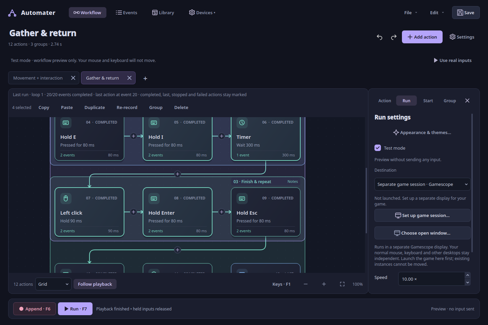

# Run a game while using your normal desktop

**Settings → Run → Separate game session · Gamescope** starts a new game display
with its own input state. Automater sends replay only to that display. Your normal
desktop cursor, keyboard focus and other virtual desktops remain independent.
This requires Gamescope, a compatible Vulkan driver/GPU and an X11-capable game.

## Sober setup

1. Finish or leave your current game and close the existing Sober instance yourself.
   A running instance cannot be moved into another display; Automater refuses to
   launch a second Sober instance rather than risk reusing the original window.
2. In Run settings, choose Separate game session and click **Set up game session…**.
3. Choose **Sober · Flatpak**, select the game resolution, and click **Launch game
   in session**. Automater does not install packages, edit Sober config or change
   persistent Flatpak permissions.
4. When the game's window appears, select it in Run settings. A sole session window
   is selected automatically. Only windows inside that session are listed here.
5. Turn **Test mode off**, configure your workflow and Run. You can switch to another
   normal window or desktop. Stop releases the session's held inputs.

Starting X/Y coordinates in this mode are relative to the game client area, not
the normal desktop. Automater resets only the session's pointer before each loop.
Desktop pointer permission and /dev/uinput are not used for this transport.
Physical recording/global hotkeys still require readable input devices.

For a different app, choose Custom application and enter its executable and
arguments. Arguments are passed directly; no shell expansion is performed. Close
pre-existing single-instance applications first. The app must open its window
inside the session; portal-launched external browsers remain outside it.

## Choose the appropriate mode

| Mode | Your normal pointer | Requirement / limitation |
| --- | --- | --- |
| Active desktop | Moves with replay | uinput; input goes to the desktop's focused app |
| Existing window · X11 | Stays independent | The app must accept synthetic X11 messages; many games/raw-input clients do not |
| Separate game session | Stays independent | New Gamescope session, compatible GPU and game; input is real XTEST inside that private display |

No mode silently falls back to desktop injection. Session startup failure, missing
target, unsupported keys or lost connection produce an error. Existing native
Wayland windows cannot be selected for independent background injection.

## Accuracy and lifecycle

The session keeps rendering at a requested 60 Hz when unfocused; the game may apply
its own throttling. Fixed resolution and unaccelerated virtual-pointer settings
make the session more predictable, but sensitivity, pointer grabs, frame rate and
game state still affect actual results. Raw recorded counts are not a universal
screen-pixel/camera mapping. Random timing and playback speed intentionally change
the original timing.

Closing Automater stops automation and leaves the launched game open. **Close game
session** explicitly closes it and asks first because game progress may be lost.
**Session diagnostics** shows bounded startup logs. If Gamescope reports no Vulkan
physical device, repair driver/device availability before trying again; Automater
will not use the desktop as an alternative destination.

The private input service is tested against a separate Xvfb server, including
pointer coordinates, window identity, real key/button events and release on
disconnect. This development environment cannot start Vulkan Gamescope, so actual
Sober/GPU compatibility is not certified. Test a harmless routine after launching
Sober before relying on a longer workflow.

## Implementation references

- [Gamescope nested displays and options](https://github.com/ValveSoftware/gamescope)
- [Gamescope display environment setup](https://github.com/ValveSoftware/gamescope/blob/master/src/main.cpp)
- [Sober configuration and official application ID](https://vinegarhq.org/Sober/Configuration/index.html)
- [Flatpak run options](https://docs.flatpak.org/en/latest/flatpak-command-reference.html)
