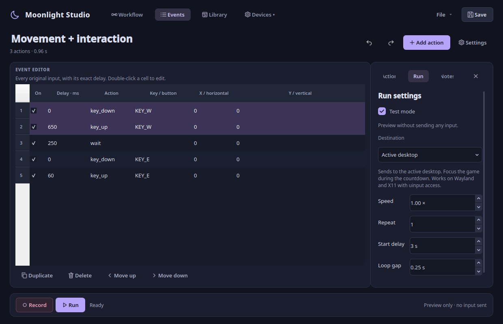
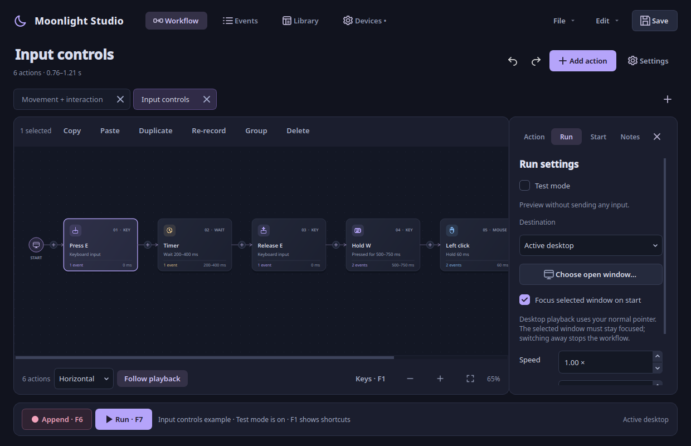
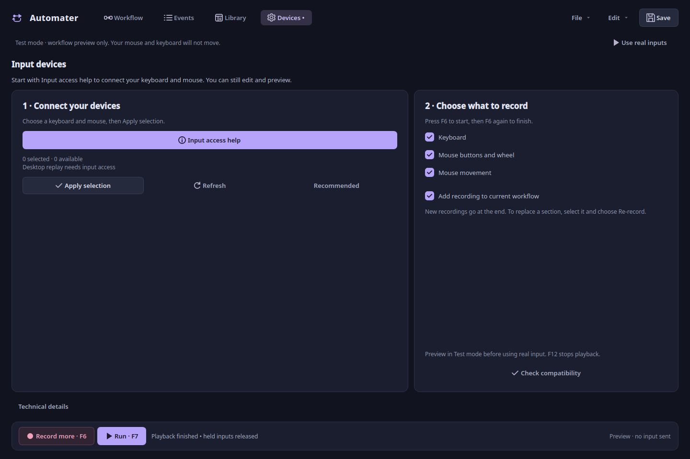
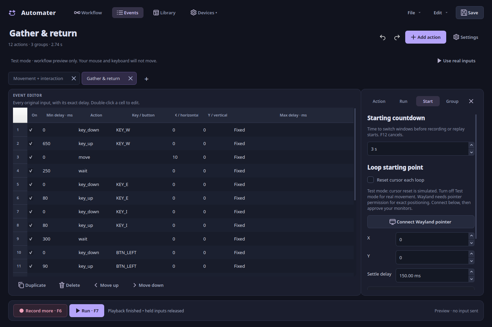
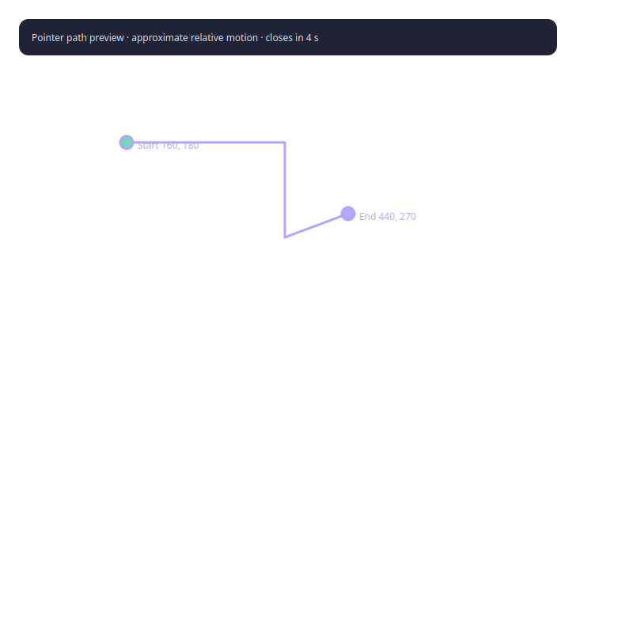
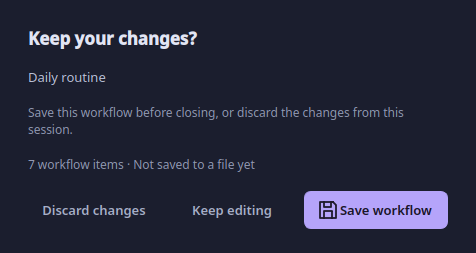

# Using Moonlight Studio

## Start with the example

Run `./start.sh --demo`. The example holds W, waits, then taps E. **Test mode** is
already enabled. Click **Run workflow** to watch the sequence without sending input.

The top navigation opens Workflow, Events, Library and Devices. Your current workflow
name is editable in the header. Save is at the top; File contains New, Open, Save as and the example. Record and Run
stay at the bottom. Pause and Stop appear during active work. The indicator shows recording, running, paused
or ready, and the line below explains what is happening.

## Build and edit

Click **Add action** to choose Hold, Mouse click, Timer, Move pointer, Scroll,
Press or Release. Search any supported keyboard key or mouse button, then set the
timing in the dialog. An action is inserted after your selection, or appended if none is selected.
The plus button on a connector inserts directly at that location.

Properties are hidden until needed. Click a card to select it; the close button
in the inspector gives the space back to the canvas. **Action** on the right shows its properties:

- **Key / button:** Choose the physical key or mouse button. A hold edits its press
  and release together.
- **Delay before:** Time to wait before beginning the action. This is separate from
  the time the key stays held.
- **Hold for:** Duration between press and release.
- **Wait for:** Duration of a standalone wait action.
- **Horizontal / Vertical:** Relative movement, or scroll notches, for a single sample.
- **Include in playback:** Disabled actions are visibly faded and their delays are skipped.

Click **Apply changes** to commit. Undo restores the previous event data. The four
buttons below Apply move left, move right, duplicate, and delete. The same actions
are in a card's right-click menu. Drag a card past a neighboring slot to reorder;
the whole action moves, including its press and release. There are no free-floating
positions to save: execution always follows the connected left-to-right order.

### Grouped paths and precise events

Matching adjacent press/release pairs are represented as one hold/click card. Explicit Press and Release controls remain separate cards. A key
pressed while another is held remains an individual press or release card, so the
workflow does not hide overlapping inputs. Grouping respects enabled boundaries.

Consecutive pointer movement or scroll samples become a single card. This does
not simplify or delete samples. **Path duration** scales the delays after its first
sample proportionally; **Delay before** changes only its first delay. If the internal
duration was zero, a new duration is distributed equally over the remaining samples.
Edits that would exceed an individual event's timing limits are rejected.

Use **Events** to edit individual samples or keys. Select multiple rows to duplicate,
delete or move them as a consecutive group. Disabling individual press/release
events can create unbalanced holds; the existing replay warning and cleanup apply.

### Explore a long routine

Mouse wheel pans horizontally. Left-drag empty canvas space to box-select; middle-drag pans in either direction.
Ctrl + wheel zooms; the bottom controls zoom in/out or fit. Zoom is bounded so a
long sequence does not turn into unreadable dots. All actions live on one continuous
canvas; scroll to reach any action. Large routines create graphics only near the
visible area, keeping every event and selection intact. **Follow playback** smoothly
moves the camera toward the running action; turn it off to inspect another area.

When dragging, a dashed marker shows the original position. A translucent card and
shifted neighbours preview the new order. Hover near an edge to scroll farther.
Release to commit one undoable move, or press Escape to cancel.

## Set up playback

Click **Settings**, or select **Run** in the inspector.

| Setting | Effect |
| --- | --- |
| Active desktop | Send through uinput to the active desktop. Focus the intended app during the countdown. |
| Background window · X11 | Select a concrete X11/Xwayland window. This experimental mode sends window events without changing focus. |
| Speed | Scale event delays from 0.1× to 10×. |
| Repeat | Number of complete cycles; zero displays “Until stopped.” |
| Start tab → Countdown | Time to switch to your destination before playback or recording starts. |
| Loop gap | Pause between cycles; the engine uses a minimum 10 ms gap. |
| Test mode | Highlight the real replay sequence without emitting input. |

Click **Choose open window** to search your currently open games and applications;
there is no file browser. On KDE Plasma this includes native Wayland windows.
Other desktops currently expose X11/Xwayland windows only. Refresh after opening
an app. A closed selected desktop window remains marked unavailable until you
choose another window; it does not silently become unrestricted desktop playback.

For **Active desktop**, **Focus selected window on start** restores
and focuses your chosen app after the countdown. Turn it off if you prefer to
focus the app yourself. After starting, switching away stops the script and releases
held inputs. This still moves your normal
pointer. Use **Use any active window** in the picker to remove that focus check.
**Existing window · X11** sends best-effort background messages. For a native
Wayland window, the picker explicitly offers **Use on active desktop** instead.
**Separate game session** lists only windows inside the game display you launched;
use that advanced mode for independent mouse/keyboard input in supported games.

The estimate includes enabled events, speed, countdown, repetitions and loop gaps.
Desktop replay allows at least 0.5 s for its new virtual device to register.
It excludes time spent paused and cannot predict operating-system or game latency.
Pause releases held inputs and resume restores them. Stop interrupts a wait and
releases held inputs. Editing is locked during playback and recording; you can
still switch between Workflow and Events to watch progress.

Background compatibility remains application-specific. Native Wayland background
delivery is unavailable. See the [platform matrix](../README.md#background-compatibility).

## Record from your devices

Open Devices, check input access, select devices, and click Apply selection.
Choose keyboard, buttons/wheel and/or movement. The permissions link explains
missing device access. If your original Moonlight clicker works, the same access
may already be available.

Press F6. After the countdown, do your routine and press F6 again. By default the result
appends to the existing workflow. To replace a part, select one action or adjacent
actions and choose **Re-record**. Discard keeps the original; Undo restores it after
finishing. Empty recordings keep existing actions. Disable **Append to current
workflow** in Devices for a confirmed replacement of all actions. F12 also finishes capture
or cancels a countdown. Control hotkeys never enter the recording. Capture in
progress stays in memory until stopped; stopping hands it to the editor and autosave.
After reconnecting a device, refresh the device list. Selection is remembered using
the device metadata, so changes to event-node numbers do not select an unrelated
input. Recommended resets the selection to discovered keyboards and mice. If
only a mouse is selected, global keyboard shortcuts will not work.

## Save and recover

**Save** saves to the current file, or asks for a destination on first
save. The default is your library. **File → Save as** writes a separate copy. Library searches filenames and workflow titles; double-click a result to open it.
It indexes known save locations and recently opened files, including older workflows
saved beside the launcher. **Add folder…** includes another directory, and Refresh
picks up files added outside Studio. Only valid workflow JSON appears; preferences
and recovery files stay out of the list. Import opens an
existing JSON script. Existing version-1 files remain readable. Advanced controls, timing ranges and
starting points use version 2 when saved; they require Studio v0.4 or newer.
Notes and named groups use version 3 and require v0.8 or newer. Existing files are
not rewritten when Library indexes them.

**Notes** stores starting position, camera direction, bindings and reminders.
An unsaved-change badge appears in the header. Idle edits are autosaved every five
seconds; startup offers recovery after an interrupted session. Saved workflows
are never silently replaced by recovery. Closing a changed tab or quitting prompts before discarding
unsaved work. See [storage and privacy](../README.md#files-and-privacy).

## Common questions

**Why does recording say setup is needed?** Studio needs access to physical devices.
Use Devices → Input access help. Test mode and editing work without those permissions.

**Why does a key appear as a press and a release instead of one card?** Other events
occur between them, or their enabled states differ. Keeping them separate preserves
the original order and simultaneous holds.

**Can I add branches or nested loops?** This release visualizes a linear macro.
Repeat the complete sequence in Settings → Run. Conditional branches and nested loops
are planned separately; drawing a connection does not create unsupported logic.

**Why did my mouse path land elsewhere?** Movement is relative, so starting position,
camera sensitivity, acceleration and game bindings matter. Put those assumptions
in Notes. This release does not record absolute screen positions.

**Will a game accept background input?** Test it on that game. Desktop uinput and
directed X11 window messages have different compatibility. The test receiver proves
message delivery, not acceptance by any particular game.

## Remembered settings

Run speed, repeats, start delay, loop gap, capture filters, append mode and Test
mode are remembered across restarts. They are app preferences, separate from the
portable macro file. Background window handles are intentionally not restored;
choose a live window each time. Corrupt preferences fall back to defaults with
a short message; Technical details contains the underlying error.

## Press, hold, release and timers

**Press** sends key-down only. Use a **Timer** while it stays down, then **Release**
that same key. **Hold** contains a press and timed release together. A mouse button
can be used with these controls too. Every loop and Stop releases outstanding holds.
For example: Press W → Timer 500 ms → Release W → Hold Space for 100 ms.

In properties, **Delay before** is a minimum when Random delay is enabled; **Up to**
is the maximum. Hold/path durations have their own random range. A new value is
sampled for each ranged event each loop, then divided by playback speed. Random
choices never change the saved minimum/maximum or shuffle action order.

Select actions and choose **Edit → Randomize selected timing** for percentage
variation. Zero delays remain zero unless you give them an explicit range. The
context menu's **Use fixed timing** removes ranges and keeps their minimum values.
**Split holds into press / release** preserves both events while showing separate cards.

## Selection and clipboard

Ctrl-click toggles a card. Shift-click selects a range. Left-drag from empty canvas
box-selects; middle-drag pans. Ctrl+A selects every action, including those offscreen.
Scrolling keeps your selection. Copy/cut/paste and duplicate act in original sequence order;
paste inserts after the last selected event, or at the end if nothing is selected.
Clipboard data is bounded, validated JSON and includes all original samples/ranges.
It does not include the workflow's starting-point configuration.

Ctrl+C copies, Ctrl+X cuts, Ctrl+V pastes, Ctrl+D duplicates, and Delete/Backspace
removes the selection. Ctrl+Z undoes, Ctrl+Shift+Z redoes, Esc clears selection.
Text boxes retain normal text-editing shortcuts. The Events view keeps precise raw
row selection even when the workflow view groups a press/release pair. F1 shows help.

Choose Horizontal, Vertical or Grid below the canvas. Layout is visual only;
numbered action order controls execution. Alt+arrows moves selected actions as a
group. Changing layout, zooming or selecting actions never changes macro timing.

## Start countdown and loop reset

Open **Settings → Start**, or click the Start marker. The initial countdown gives
you time to switch windows; the large countdown banner has a Cancel button and F12
always stops. Add a Timer action if you also need a delay inside each loop.

Enable the starting point and set X/Y plus settle time. The cursor moves first on
**every loop**, waits the settle interval, then begins the actions. Pick position
waits three seconds and reads the cursor without moving it. F12 cancels capture;
a late result from a cancelled pick is ignored.

Coordinates are saved with the script. X11 and Hyprland support direct positioning.
On KDE or another Wayland desktop, use **Connect Wayland pointer**, approve pointer
control and select physical monitors. This requires a compatible desktop portal.
The connection is temporary and closes with Studio. No screen frames are read or saved.
Use **Choose on screen** to click a location, and **Show starting point** to check it.
A portal acknowledgment is not a guarantee that a game accepted the move. Background
coordinates are relative to the selected X11 window's client area and do not move
or capture the real pointer. The target must still be chosen each session. Switching
to another workflow restores its saved starting point or turns reset off if it has none.

## Edit matching actions together

Select matching Holds, Presses, Releases, Timers, Moves or Scrolls. The Action panel
shows **Apply to N actions**. Different values show Mixed or Multiple keys. Change
only the fields you want copied, then Apply. Untouched keys, coordinates, durations
and timing ranges stay as they are. One undo restores the whole batch. Holds and
standalone Press/Release controls are different types. Mixed action types retain
copy/delete/randomize; select matching types for shared properties.

## Pointer path guides

Select a movement card and choose **Show pointer path** in its properties or the
context menu. The guide marks start/end and disappears after four seconds. It is
click-through and sends no input. If the script has no starting point, click a
preview origin first. Esc/F12 or right-click cancels a point picker. The point is
chosen on mouse release so the selection click is not passed to another app.

Recorded movement is relative device counts. Desktop scaling, acceleration and game
sensitivity affect the actual path, so this guide is approximate. It is not screen
matching or a prediction of a game's camera. Background coordinates are window-local;
desktop overlays are unavailable for that routing mode.

## Playback runs but the mouse does not move

Check the visible **Test mode** line first. Test mode intentionally emits nothing;
click **Use real inputs** to leave preview mode. In background mode the real cursor
stays where it is. For desktop reset on KDE Wayland, connect pointer control in
Start settings first. A permission or input-device error is shown in the status bar;
hover it for the full message. See [pointer support](POINTER.md).

## Multiple workflows

Use + or Ctrl+T for a workflow tab. Opening a file or example creates another tab;
opening a file already loaded activates its tab and preserves unsaved changes.
Tabs have independent undo/redo, selected actions, layout/zoom, starting coordinates,
run settings and recovery files. * means unsaved. Ctrl+W closes the active tab;
Ctrl+Tab and Ctrl+Shift+Tab switch. Closing the last tab leaves a blank workflow.
Tabs are locked during recording/playback so feedback and new captures stay with
one document. Saving cannot overwrite a file open in a different tab.

## Run independently while using another window

Choose **Settings → Run → Separate game session · Gamescope** and click
**Set up game session…**. Pick Sober, close any existing Sober instance, and launch.
Select its game window in Run settings, turn off Test mode, and Run. Gamescope needs
compatible Vulkan/GPU support. This mode never falls back to desktop injection.
See the [full setup and compatibility guide](ISOLATED_SESSIONS.md).

## Understand playback and its last result

The countdown uses the replay worker's monotonic deadline. Input checks and target
setup happen before that countdown. Delay, Timer, cursor reset/settle, pause and
loop gap have distinct states. Held keys and a Timer can be active together. A
future key press is not highlighted until it is dispatched. The UI shows the
latest worker snapshot about 30 times per second, rather than replaying a queue of
old highlights. Input scheduling is independent of the UI timer.

After Finish, Stop or failure, the latest loop's results remain:

- **Green:** the action completed.
- **Blue:** the last completed action.
- **Amber:** the action in progress when stopped.
- **Red:** the step that failed or could not continue.

Unexecuted actions remain neutral. For grouped movement/holds, all enabled samples
must finish before the card is marked completed. **Edit → Last playback details**
shows completed events, failure, requested/actual loop time and maximum measured
dispatch lateness. These measurements cannot confirm receipt by the game. Details
exclude countdown/reset/gap and paused time from actual loop duration. Edits or a
new run clear old markers; switching tabs preserves each tab's latest result.

## When recording and playback differ

Use speed **1×**, fixed timings, the same game bindings/sensitivity and a consistent
starting position/camera. Relative mouse counts are preserved; desktop acceleration,
scaling, a virtual mouse's settings and the game's input/frame handling can change
the visible path. A starting cursor coordinate does not reset a game's camera or
character state. Start with a short harmless routine and inspect **Edit → Last
playback details** for missed deadlines or a failed action.

Replay maintains the recorded cumulative schedule and protects hold/release
intervals against late sends. Recording uses kernel timestamps across ready devices
and accepts events at the actual countdown deadline even if the UI is busy. These
fixes reduce internal drift; they cannot confirm that a game accepted every event.
New recordings benefit from capture fixes; existing JSON timings are kept unchanged.

Saved tab labels use the filename without `.json`. Open and Save As start in the
active file's folder, otherwise the last used folder, otherwise the workflow library.
The editable workflow title inside a JSON file remains independent of its filename.

## Add explanations and visual categories

Choose **Add action → Note / text…**, **Edit → Add workflow note**, or press
**Ctrl+Shift+N**. Enter a title and plain text. Click the note later to edit it in
the inspector, drag to move it, or copy/delete it like another card. Notes never
emit keyboard/mouse input and never add time to playback. The canvas shows a short
preview; the inspector retains the complete explanation (up to 4,000 characters).

Select cards, then click **Group**, use **Ctrl+G**, or choose Group selection in the
context menu. Name the category and choose its color. A border surrounds the
selected actions; a group spanning grid rows repeats its heading on each row.
Nonadjacent selections retain their order and get separate border segments,
without enclosing the unselected actions between them. These are visual categories,
not loops or executable branches.

Click a group header to select every member. Right-click it to rename/change color
or ungroup. **Ctrl+Shift+G** removes selected actions from their groups. Group changes
and note edits are undoable; copy/paste between tabs copies the required metadata
and creates independent group identities.

## Live capture preview

During recording, a preview above the editor shows the most recent actions, total
captured events, elapsed time and currently held inputs. The original workflow stays
intact until you finish. **F6** adds the captured events using the append/re-record
mode you chose; **Discard** keeps the previous workflow. In-progress capture remains
in memory, so finish the recording before closing Studio.

## Manage tabs and unsaved changes

Right-click a tab for Rename, Save, Save as, Close workflow and Close other workflows.
Double-click a tab to rename it. Renaming a saved workflow moves its JSON file within
the same folder, refuses an existing destination, and keeps unsaved edits in memory.
The updated internal workflow title is persisted when you Save. Closing a tab does
not delete its saved JSON file.

The unsaved badge sits beside the summary below the workflow title. Closing changed
work opens Studio's save dialog: **Save workflow** writes your changes, **Discard
changes** keeps the last saved file, and **Keep editing** or Escape cancels closing.
Cancelling the file chooser during Save also leaves the tab open.

## Wide screens and smooth following

Grid columns follow the visible width, current zoom and properties panel. The
layout reflows after a pointer gesture finishes, keeping dragging and box selection
stable while properties open. Selection and raw input data do not change.

Playback uses a continuously updated camera with retained velocity when targets
change. It stays separate from replay timing. Turn **Follow playback** off to pan
freely, then turn it on to return to the current action. Shorter-than-frame inputs
are represented by the latest worker snapshot; the UI cannot display every physical
event as a separate rendered frame.
