# Using Automater

The screenshots show the real app with example data, captured offscreen. Window names
and the recording preview are filled in for the screenshots. Fonts and scaling may look
different on your desktop.

## Build your first workflow

On first launch, choose **Start example** to build a small workflow in a new tab: **Hold
Space for 500 ms → Timer for 300 ms → Hold E for 100 ms**. Your other tabs stay open.

Follow the hints beside the controls, then click **Next** when each task is done. Use
**Back** to revisit a step, or **Skip** or Escape to leave the guide. Skipping keeps any
actions you have added; an untouched example tab is closed.

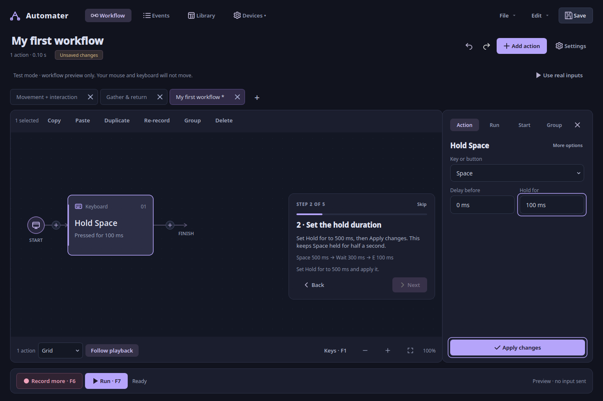

The last step runs the complete example in **Test mode**, without sending input. When it
finishes, choose **Create my own** for a blank workflow or **Keep editing** to work on
the example. You can save the example with **Save**. If the run stops or fails, the
guide stays on the Run step so you can try again.

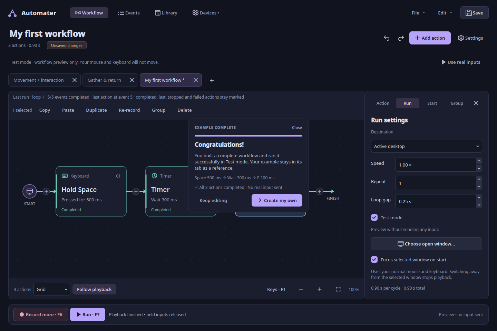

Reopen the guide from **File → Guided example**, or **Build your first workflow** on an
empty canvas. Recording is available after you finish or skip the guide.

## Start with the example

Run `./start.sh --demo`. The example holds W, waits, then taps E. **Test mode** is
already enabled. Click **Run** to watch the sequence without sending input.

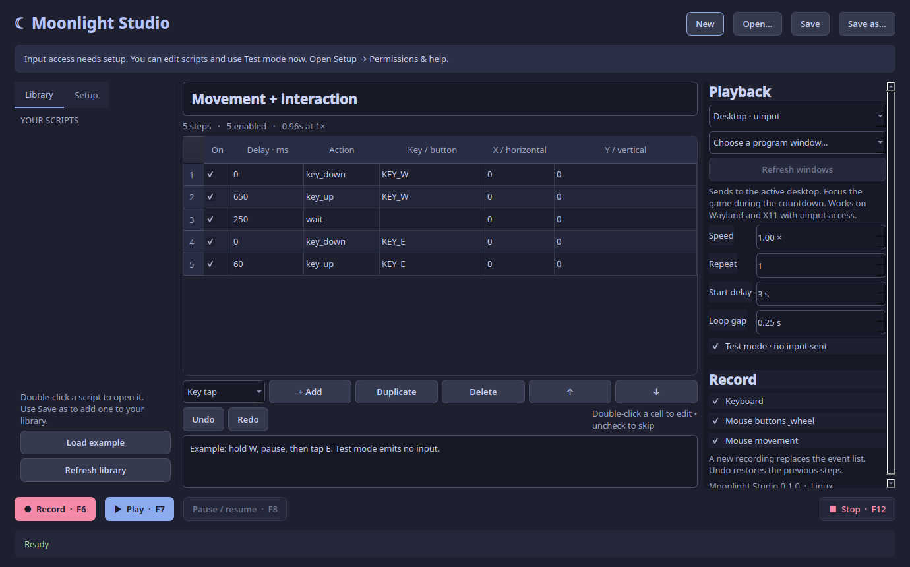

Use the top navigation to switch between Workflow, Events, Library and Devices. Click
the workflow title to rename it. **Save** is at the top; **Record** and **Run** are at
the bottom. During recording or playback, the status line shows what is happening and
the controls change to Pause and Stop as needed.

## Build and edit

Click **Add action** to choose Hold, Mouse click, Timer, Move pointer, Scroll, Press or
Release. Search any supported keyboard key or mouse button, then set the timing in the
dialog. An action is inserted after your selection, or appended if none is selected. The
plus button on a connector inserts directly at that location.

Click a card to open its properties in the **Action** panel. Close the panel to make
more room for the workflow. The fields depend on the selected action:

- **Key or button:** Choose the physical key or mouse button. A hold edits its press
  and release together.
- **Delay before:** Time to wait before beginning the action. This is separate from
  the time the key stays held.
- **Hold for:** Duration between press and release.
- **Wait for:** Duration of a standalone wait action.
- **Horizontal / Vertical:** Relative movement, or scroll notches, for a single sample.
- **Enabled:** Disabled actions are visibly faded and their delays are skipped.

Type a key name to search the picker. Timing fields accept fractional milliseconds.
**More options** contains Enabled, random timing, pointer-path preview and Re-record.

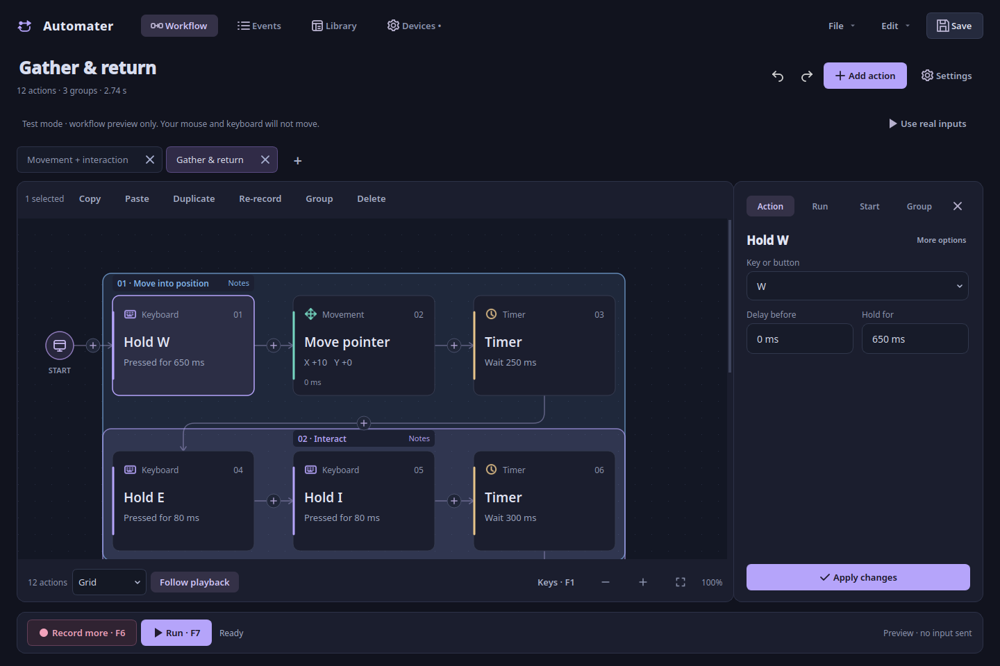

Click **Apply changes** to save the edit. Undo brings back the previous values. The four
buttons below Apply move left, move right, duplicate, and delete. The same actions are
in a card's right-click menu. Drag a card past a neighboring slot to reorder; the whole
action moves, including its press and release. The numbered order determines which
action runs next.

### Grouped paths and precise events

A matching press and release appear as one hold or click card when they are adjacent.
Actions added with Press and Release stay separate. If other input happens between a
recorded press and release, they also stay separate so you can see overlapping holds.
Events with different enabled states are kept apart.

Consecutive movement or scroll samples appear in one card, but every sample is kept.
**Path duration** scales the time between samples; **Delay before** changes the wait
before the first one. If a path has no duration yet, the new duration is shared equally
between its remaining samples. An edit is rejected if it would put an event outside the
allowed timing range.

Use **Events** to edit individual samples or keys. Select multiple rows to duplicate,
delete or move them as a consecutive group. Disabling individual press/release events
can create unbalanced holds; the existing replay warning and cleanup apply.

### Explore a long routine

Mouse wheel pans horizontally. Left-drag empty canvas space to box-select; middle-drag
pans in either direction. Ctrl + wheel zooms; the bottom controls zoom in/out or fit.
Scroll to reach actions outside the visible area. **Follow playback** moves the view
toward the running action; turn it off to look elsewhere.

When dragging, a dashed marker shows the original position. A translucent card and
shifted neighbours preview the new order. Hover near an edge to scroll farther. Release
to commit one undoable move, or press Escape to cancel.

## Set up playback

Click **Settings**, or select **Run** in the inspector.

| Setting | Effect |
| --- | --- |
| Active desktop | Send through uinput to the active desktop. Focus the intended app during the countdown. |
| Background window · X11 | Send input to a selected X11/Xwayland window without focusing it. Some apps ignore this input. |
| Speed | Scale event delays from 0.1× to 10×. |
| Repeat | Number of complete cycles; zero displays “Until stopped.” |
| Start tab → Countdown | Time to switch to your destination before playback or recording starts. |
| Loop gap | Pause between cycles; the engine uses a minimum 10 ms gap. |
| Test mode | Preview the sequence without sending keyboard or mouse input. |

Click **Choose open window** to find a running app. KDE Plasma can list native Wayland
windows; other desktops currently list X11/Xwayland windows. Refresh after opening an
app. If your selected window closes, choose another before running.

For **Active desktop**, **Focus selected window on start** restores and focuses your
chosen app after the countdown. Turn it off if you prefer to focus the app yourself.
After starting, switching away stops the script and releases held inputs. This still
moves your normal pointer. Use **Use any active window** in the picker to remove that
focus check. **Background window · X11** sends best-effort background messages. For a
native Wayland window, the picker explicitly offers **Use on active desktop** instead.
**Separate game session** lists only windows inside the game display you launched; use
that advanced mode for independent mouse/keyboard input in supported games.

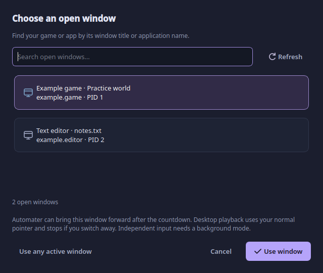

The time estimate includes enabled actions, speed, countdown, repetitions and loop gaps.
Desktop playback also waits at least half a second for its virtual input device to
register. Pauses and system delays can make a run take longer. Pause releases held
inputs and resume restores them. Stop interrupts a wait and releases held inputs.
Editing is locked during playback and recording; you can still switch between Workflow
and Events to watch progress.

Background playback depends on the app. Existing native Wayland windows cannot receive
background input. See the [platform
matrix](COMPATIBILITY.md#desktop-and-display-server-features).

## Record from your devices

Open Devices, check input access, select devices, and click Apply selection. Choose
keyboard, buttons/wheel and/or movement. The permissions link explains missing device
access. If your original Moonlight clicker works, the same access may already be
available.

Use **Record** (or **Record more** when adding to a routine), or press F6. After the
countdown, do your routine and press F6 again. By default the result appends to the
existing workflow. To replace a part, select one action or adjacent actions and choose
**Re-record**. Discard keeps the original; Undo restores it after finishing. Empty
recordings keep existing actions. Disable **Add recording to current workflow** in
Devices for a confirmed replacement of all actions. F12 also finishes capture or cancels
a countdown. Recording-control keys are left out of the recording. Finish recording
before closing the app: unfinished recordings are held in memory. After reconnecting a
device, refresh the device list. Automater remembers devices by their details rather
than just their event-node numbers. **Recommended** selects the keyboards and mice it
finds. If only a mouse is selected, global keyboard shortcuts will not work.

## Save and recover

**Save** saves to the current file, or asks for a destination on first save. The default
is your library. **File → Save as** writes a separate copy. Library searches filenames
and workflow titles; double-click a result to open it. It indexes known save locations
and recently opened files, including older workflows saved beside the launcher. **Add
folder…** includes another directory, and Refresh picks up files added outside
Automater. Only valid workflow JSON appears; preferences and recovery files stay out of
the list. Import opens an existing JSON script. Existing version-1 files remain
readable. Advanced controls, timing ranges and starting points use version 2 when saved;
they require Automater v0.4 or newer. Named groups use version 3; group explanations use
version 4 and require v0.9 or newer. Existing files are not rewritten when Library
indexes them or converts older inline note cards for display. Save explicitly to persist
the conversion.

**Group notes** let you describe a starting position, camera direction, bindings and
reminders for a section. These are written reminders; they do not configure playback.
Use **Settings → Start** to set an actual cursor reset. An unsaved-change badge appears
in the header. Idle edits are autosaved every five seconds; startup offers recovery
after an interrupted session. Saved workflows are never silently replaced by recovery.
Closing a changed tab or quitting prompts before discarding unsaved work. See [storage
and privacy](../README.md#files-and-privacy).

## Common questions

**Why does recording say setup is needed?** Automater needs access to physical devices.
Use Devices → Input access help. Test mode and editing work without those permissions.

**Why does a key appear as a press and a release instead of one card?** Other events
occur between them, or their enabled states differ. Keeping them separate preserves the
original order and simultaneous holds.

**Can I add branches or nested loops?** No. Workflows run in order. You can repeat the
whole workflow in **Settings → Run**.

**Why did my mouse path land elsewhere?** Movement is relative, so starting position,
camera sensitivity, acceleration and game bindings matter. Put those assumptions in
group notes. This release does not record absolute screen positions.

**Will a game accept background input?** It depends on the game. Try a short workflow
first. Desktop playback and background X11 playback send input in different ways, so one
may work where the other does not.

## Remembered settings

Run speed, repeats, start delay, loop gap, capture filters, append mode and Test mode
are remembered across restarts. They are app preferences, separate from the portable
macro file. Choose a destination window again after restarting; old window IDs are not
reused. If preferences cannot be read, Automater uses defaults and shows a message.
**Technical details** shows the error.

## Press, hold, release and timers

**Press** sends key-down only. Use a **Timer** while it stays down, then **Release**
that same key. **Hold** contains a press and timed release together. A mouse button can
be used with these controls too. Every loop and Stop releases outstanding holds. For
example: Press W → Timer 500 ms → Release W → Hold Space for 100 ms.

In properties, **Delay before** is a minimum when Random delay is enabled; **Up to** is
the maximum. Hold/path durations have their own random range. A new value is sampled for
each ranged event each loop, then divided by playback speed. Random choices never change
the saved minimum/maximum or shuffle action order.

Select actions and choose **Edit → Randomize selected timing** for percentage variation.
Zero delays remain zero unless you give them an explicit range. The context menu's **Use
fixed timing** removes ranges and keeps their minimum values. **Split holds into press /
release** preserves both events while showing separate cards.

## Selection and clipboard

Ctrl-click toggles a card. Shift-click selects a range. Left-drag from empty canvas
box-selects; middle-drag pans. Ctrl+A selects every action, including those offscreen.
Scrolling keeps your selection. Copy/cut/paste and duplicate act in original sequence
order; paste inserts after the last selected event, or at the end if nothing is
selected. Copying keeps the selected actions' samples and timing ranges. It does not
copy the workflow's starting point.

Ctrl+C copies, Ctrl+X cuts, Ctrl+V pastes, Ctrl+D duplicates, and Delete/Backspace
removes the selection. Ctrl+Z undoes, Ctrl+Shift+Z redoes, Esc clears selection. Text
boxes retain normal text-editing shortcuts. The Events view keeps precise raw row
selection even when the workflow view groups a press/release pair. F1 shows help.

Choose Horizontal, Vertical or Grid below the canvas. Layout is visual only; numbered
action order controls execution. Alt+arrows moves selected actions as a group. Changing
layout, zooming or selecting actions never changes macro timing.

## Start countdown and loop reset

Open **Settings → Start**, or click the Start marker. The initial countdown gives you
time to switch windows; the large countdown banner has a Cancel button and F12 always
stops. Add a Timer action if you also need a delay inside each loop.

Enable the starting point and set X/Y plus settle time. The cursor moves first on
**every loop**, waits the settle interval, then begins the actions. Pick position waits
three seconds and reads the cursor without moving it. F12 cancels the position picker.

Coordinates are saved with the script. X11 and Hyprland support direct positioning. On
KDE or another Wayland desktop, use **Connect Wayland pointer**, approve pointer control
and select physical monitors. This requires a compatible desktop portal. The connection
is temporary and closes with Automater. No screen frames are read or saved. Use **Choose
on screen** to click a location, and **Show starting point** to check it. A game may
still ignore a move that the portal reports as successful. Background coordinates are
relative to the selected X11 window's client area and do not move or capture the real
pointer. The target must still be chosen each session. Switching to another workflow
restores its saved starting point or turns reset off if it has none.

| Destination | Starting-point coordinates |
| --- | --- |
| X11 active desktop | Root-window screen pixels. |
| Hyprland active desktop | Global logical pixels, including negative monitor positions. |
| Wayland pointer portal | Approved physical-monitor logical coordinates; monitor metadata is required. |
| Background X11 or separate game session | Selected window's client-area pixels; your real cursor stays independent. |
| Test mode | Simulation only; no pointer moves. |

If pointer permission is denied or the connection closes, cursor reset stops. You can
still replay relative movement with reset turned off if input access works. A cursor
reset does not reset your character, camera or game state.

## Edit matching actions together

Select matching Holds, Presses, Releases, Timers, Moves or Scrolls. The Action panel
shows **Apply to N actions**. Different values show Mixed or Multiple keys. Change only
the fields you want copied, then Apply. Untouched keys, coordinates, durations and
timing ranges stay as they are. Undo reverts the whole edit. Holds and separate
Press/Release actions count as different types. You can still copy, delete or randomize
a mixed selection; select matching types to edit shared properties.

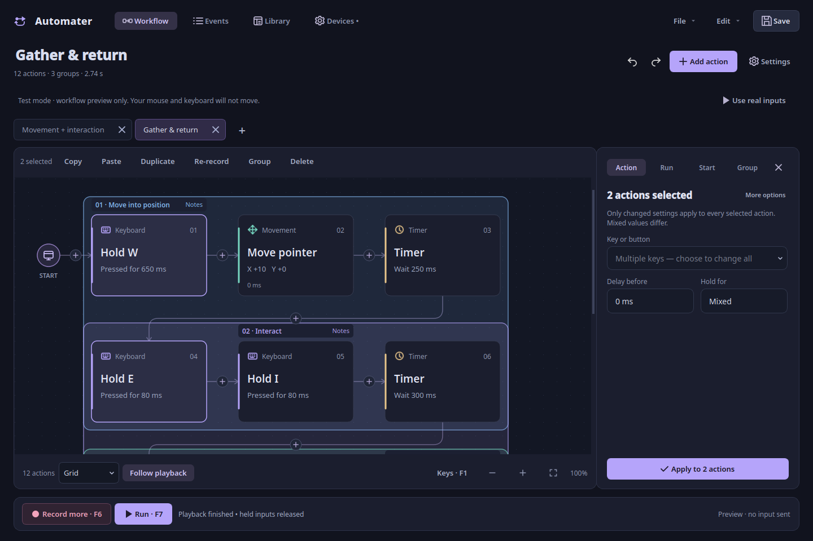

## Pointer path guides

Select a movement card and choose **Show pointer path** in its properties or the context
menu. The guide marks start/end and disappears after four seconds. It is click-through
and sends no input. If the script has no starting point, click a preview origin first.
Esc/F12 or right-click cancels a point picker. The point is chosen on mouse release so
the selection click is not passed to another app.

Recorded movement is relative device counts. Desktop scaling, acceleration and game
sensitivity affect the actual path, so this guide is approximate. It is not screen
matching or a prediction of a game's camera. Background coordinates are window-local;
desktop overlays are unavailable for that routing mode.

## Playback runs but the mouse does not move

Check the visible **Test mode** line first. Test mode intentionally emits nothing; click
**Use real inputs** to leave preview mode. In background mode the real cursor stays
where it is. For desktop reset on KDE Wayland, connect pointer control in Start settings
first. A permission or input-device error is shown in the status bar; hover it for the
full message. See [starting-point setup](#start-countdown-and-loop-reset).

## Multiple workflows

Use + or Ctrl+T for a workflow tab. Opening a file or example creates another tab;
opening a file already loaded activates its tab and preserves unsaved changes. Tabs have
independent undo/redo, selected actions, layout/zoom, starting coordinates, run settings
and recovery files. * means unsaved. Ctrl+W closes the active tab; Ctrl+Tab and
Ctrl+Shift+Tab switch. Closing the last tab leaves a blank workflow. Tabs are locked
during recording/playback so feedback and new captures stay with one document. Saving
cannot overwrite a file open in a different tab.

Saved tabs show the filename without `.json`. Open and Save as start in the active
file's folder, then fall back to the last folder or the library. The workflow title
stored inside a file can differ from its filename.

## Run independently while using another window

This mode launches a new game display with independent input. It requires Gamescope, a
compatible Vulkan driver/GPU and an X11-capable game. An already running game cannot be
moved into the session.

1. Close any existing Sober instance yourself. Automater refuses to launch a second
   instance that might reuse your ordinary desktop window.
2. Choose **Settings → Run → Separate game session · Gamescope**, then
   **Set up game session…**.
3. Choose **Sober · Flatpak**, set the resolution, and click **Launch game in session**.
   Automater does not install Gamescope or change persistent Flatpak permissions.
4. Select the game window in Run settings. Only windows inside that session appear;
   a sole window is selected automatically.
5. Turn Test mode off and run a short routine. You can use another desktop or window
   while it runs. Stop releases held inputs inside the game session.

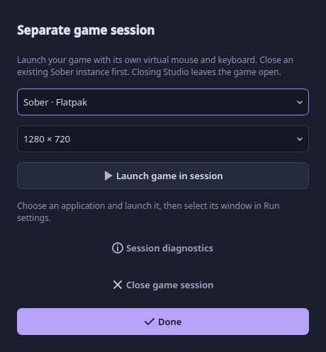

For another app, choose Custom application and enter its executable and arguments.
Arguments are passed directly, without shell expansion. Close existing single-instance
apps first; the destination must open inside the new session.

Starting X/Y coordinates refer to the game client area. This mode does not need desktop
pointer permission or `/dev/uinput`. Recording and global shortcuts still need readable
input devices. If the session or input fails, playback stops; it does not switch to
sending input to your desktop. An existing native Wayland window cannot be used as this
mode's destination.

Closing Automater stops automation and leaves the launched game open. **Close game
session** asks before closing it because game progress could be lost. Use **Session
diagnostics** for startup logs. A missing Vulkan device requires working GPU/driver
access. Game sensitivity, pointer grabs and frame handling still affect replay; physical
Gamescope/Sober compatibility needs testing on your machine.

## Understand playback and its last result

Before the countdown, Automater checks input access and prepares the destination. During
playback, the status shows whether it is waiting, moving to the starting point, running
an action or pausing between loops. Held keys can stay highlighted while a Timer runs.
Very short actions may finish between display updates; playback timing does not depend
on the animation frame rate.

Connections change color as actions finish. A moving stream points toward the current
action or the next waiting input, and freezes when you pause or stop.

After Finish, Stop or failure, the latest loop's results remain:

- **Green:** the action completed.
- **Blue:** the last completed action.
- **Amber:** the action in progress when stopped.
- **Red:** the step that failed or could not continue.

Unexecuted actions remain neutral. For grouped movement/holds, all enabled samples must
finish before the card is marked completed. **Edit → Last playback details** shows
completed events, failure, requested/actual loop time and maximum measured dispatch
lateness. The timing figures exclude countdown, cursor reset, loop gaps and pauses. They
show what Automater sent, but cannot confirm that the game received it. Changing actions
or starting another run clears the markers; switching tabs keeps each workflow's latest
result.

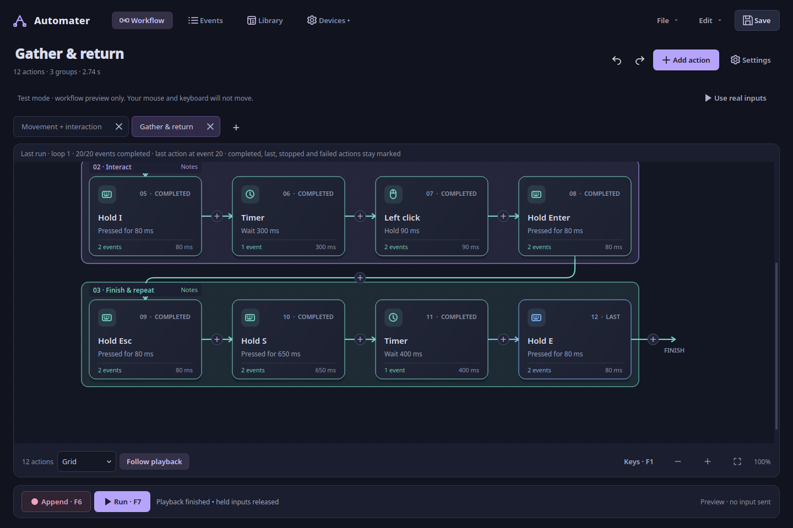

## When recording and playback differ

Use speed **1×**, fixed timings, the same game bindings/sensitivity and a consistent
starting position/camera. Relative mouse counts are preserved; desktop acceleration,
scaling, a virtual mouse's settings and the game's input/frame handling can change the
visible path. A starting cursor coordinate does not reset a game's camera or character
state. Start with a short harmless routine and inspect **Edit → Last playback details**
for missed deadlines or a failed action.

## Add explanations and visual categories

Select cards with Ctrl-click, Shift-click or a left-drag selection box. Click **Group**,
press **Ctrl+G**, or choose Group selection in the context menu. Give the section a
name, color and optional explanation. One translucent rectangle surrounds all its
members, including across grid rows. For a nonadjacent selection, the rectangle can
enclose other cards; only the selected cards belong to the group. Groups only organize
actions and store notes; they do not change playback.

Click the rectangle's background or heading to select its members and open the **Group**
panel. Edit its name, color or plain-text notes (up to 20,000 characters). Changes apply
to the document after a short pause; **Apply notes** applies immediately. Save the
workflow to write them to its JSON file. **Ctrl+Shift+N** opens notes for the selected
group, or creates a group for ungrouped actions. Dragging across a rectangle still
box-selects actions; middle-drag still pans.

Right-click the rectangle for Open group notes, Select group actions and Remove group.
**Ctrl+Shift+G** removes selected actions from their groups. Group changes and note
edits are undoable; copy/paste between tabs copies their metadata and creates separate
groups. Editing names, colors or notes preserves last-run highlights. Editing executable
input clears those results.

Standalone note cards are no longer offered. Older cards convert to nearby group notes
on opening without changing recorded input timing/order. A file containing only notes
retains them as an imported workflow description in the Group panel.

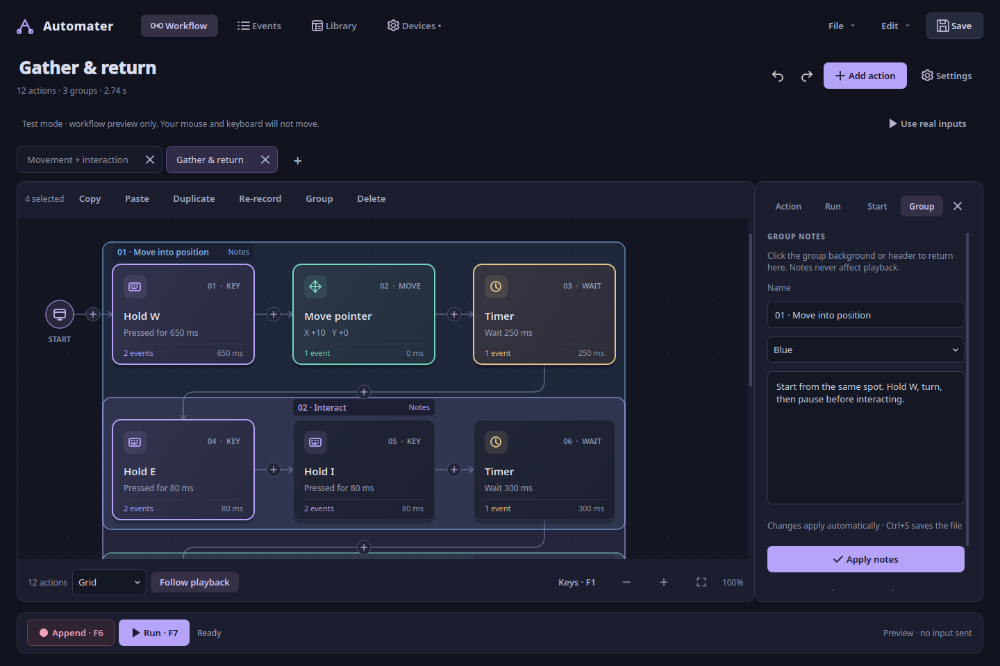

## Live capture preview

During recording, a preview above the editor shows the most recent actions, total
captured events, elapsed time and currently held inputs. The original workflow stays
intact until you finish. **F6** adds the captured events using the append/re-record mode
you chose; **Discard** keeps the previous workflow. In-progress capture remains in
memory, so finish the recording before closing Automater.

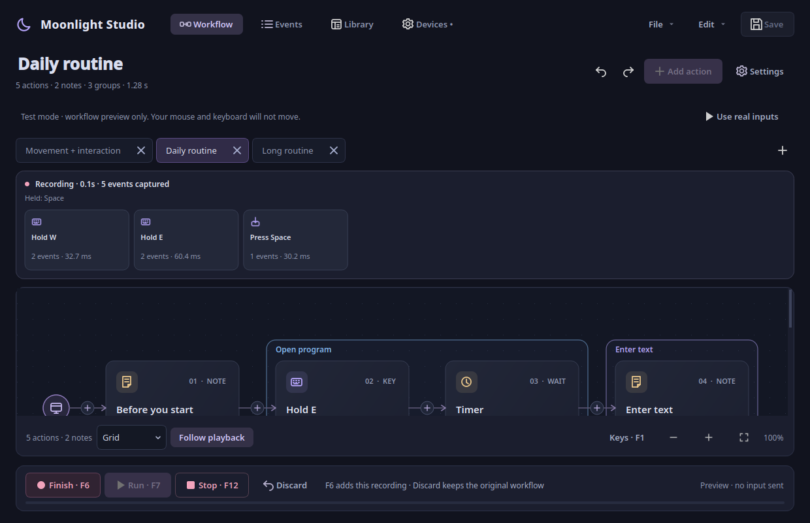

## Manage tabs and unsaved changes

Click **+** beside the tabs, or press **Ctrl+T**, for a new workflow. Right-click a tab
for Rename, Save, Save as, Close workflow and Close other workflows. Double-click a tab
to rename it. Renaming a saved workflow moves its JSON file within the same folder,
refuses an existing destination, and keeps unsaved edits in memory. The title stored
inside the file is updated when you save. Closing a tab does not delete its saved JSON
file.

The unsaved badge sits beside the summary below the workflow title. Closing changed work
opens Automater's save dialog: **Save workflow** writes your changes, **Discard
changes** keeps the last saved file, and **Keep editing** or Escape cancels closing.
Cancelling the file chooser during Save also leaves the tab open.

## Wide screens and smooth following

Grid layout adjusts to the window width, zoom and open properties panel. It waits until
you finish dragging or selecting before rearranging cards.

**Follow playback** keeps the current action in view. Turn it off to pan elsewhere, and
back on to return to the running action. Older held keys keep their highlights while the
view follows newer actions.

## Appearance and the quick guide

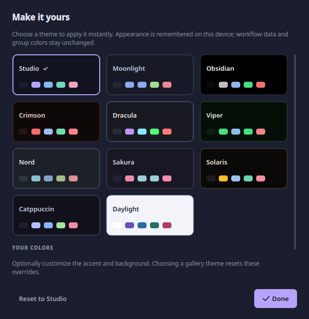

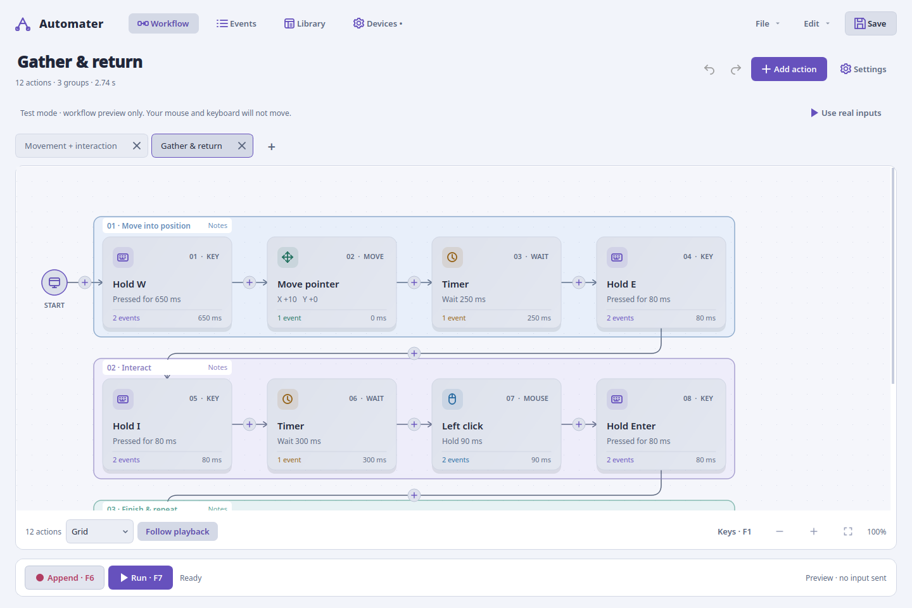

Open **File → Appearance & themes**, or press **Ctrl+,**. The gallery includes Automater
plus Moonlight, Obsidian, Crimson, Dracula, Viper, Nord, Sakura, Solaris, Catppuccin and
Daylight. Click a card to apply it; accent and background color pickers add local
overrides. Choosing another gallery card clears the overrides. Reset to Automater
restores the original look.

Themes are saved in app preferences. They do not change your workflow or its saved group
colors. Labels adjust for contrast against custom backgrounds. Stop recording or
playback before changing appearance; the gallery is disabled while either runs.

**File → Getting started** and **Quick guide** on the empty canvas explain action
creation, Hold/Press/Release, selection, duplication, groups, playback destinations and
saving without requiring a browser. Ctrl+Z inside a text field uses its native text
history; on the canvas it undoes workflow edits. Toolbar Undo/Redo apply to the
document. Applying notes changes the document; Ctrl+S saves the JSON file.

## Linux compatibility

**Devices → Check compatibility** and **File → Linux compatibility** explain the
detected distro, desktop, display server, pointer method and input requirements. Use
**Check pointer portal** to check support without opening a permission dialog. Use
**Connect Wayland pointer** to grant pointer access.

Core recording and desktop replay use Linux input devices on X11 and Wayland. Window
discovery, absolute reset and background modes have different requirements. On a Wayland
desktop that does not expose native windows, choose **Any active window**, then focus
the game during the countdown. This mode cannot guard focus of an app the desktop does
not expose. See the [matrix](COMPATIBILITY.md).
